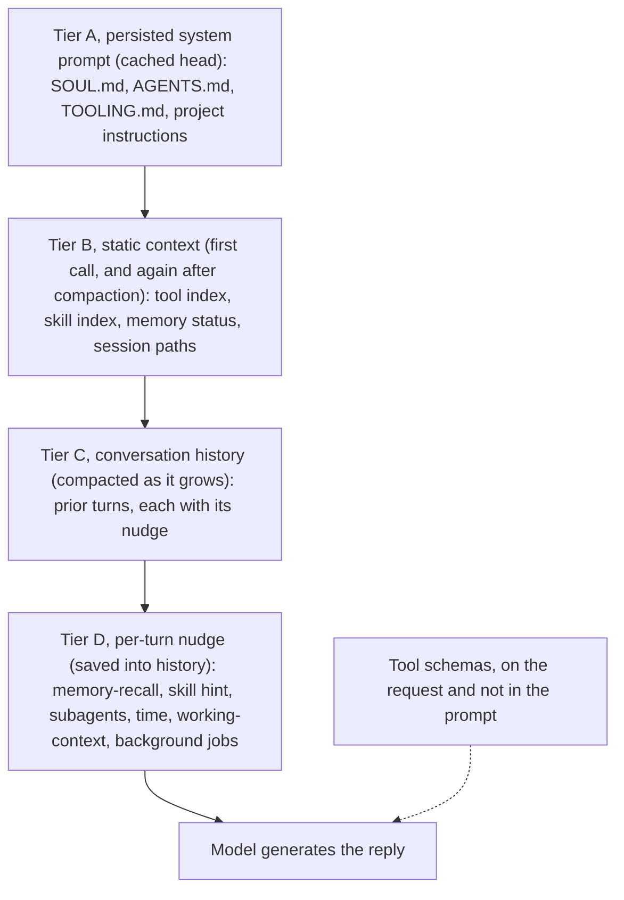

Everything the model sees on a turn is assembled from layers, in a fixed order. netclaw doesn't hand the model one blob of text. It stacks a persisted system prompt, a block of static context, the conversation history and a fresh per-turn nudge, then attaches the tool schemas separately on the request.

The order is deliberate, and it's built for [prompt caching](https://www.anthropic.com/news/prompt-caching). The stable material sits at the front so the provider can reuse the cached prefix across turns, and the material that changes every turn sits at the back near the model's generation point. That's why the current git state is injected late and your persona sits first.

What each layer contains, and whether it appears at all, depends on the session's [audience](/security/security-model/#trust-audiences). A `Public` turn gets a deliberately thin stack. `Team` and `Personal` get the full one.

## The layers



### Tier A: the persisted system prompt

Built once and stored as the head of the conversation, then rebuilt only when its inputs change. Byte-identical content is left alone to preserve the cache. Four identity layers, concatenated in order:

| Layer | What it is | Source |
|-------|-----------|--------|
| `SOUL.md` | Persona, tone, your name | `~/.netclaw/identity/SOUL.md` |
| `AGENTS.md` | Operating rules: the built-in core plus your deployment playbook | embedded in netclaw, plus `~/.netclaw/identity/AGENTS.md` |
| `TOOLING.md` | What the host can actually do | `~/.netclaw/identity/TOOLING.md` |
| Project instructions | Repo-specific rules | first of `.netclaw/AGENTS.md`, `CLAUDE.md`, `AGENTS.md`, `CONTEXT.md` in the project directory |

The `AGENTS.md` layer has two halves: an operating core compiled into netclaw (a stripped-down variant on `Public`) and the deployment playbook you write at `~/.netclaw/identity/AGENTS.md`. Project instructions follow the same `AGENTS.md` and `CLAUDE.md` convention other coding tools use, but are read from the project directory.

### Tier B: static context

Layers that don't change over a session's life. They're rendered on the first model call and again right after a compaction, which resets the context, and otherwise they stay out of the way so they never churn the cached prefix:

| Layer | What it is | Empty when |
|-------|-----------|------------|
| Tool index | A compressed, audience-filtered catalog of available tools, for awareness and not invocation | - |
| Skill index | The loaded skill inventory | `Public`, or skills disabled |
| Memory status | Whether the memory subsystem is healthy, and how to use its tools | `Public`, or memory disabled |
| `[session]` | Session id plus five paths: `session_dir`, `temp_dir`, `artifact_dir`, `worktree_dir` and `log_path`, with short guidance on using them | id only on `Public` |
| `[attachments]` hint | How to handle attached files | `file_read` not granted |

The tool index is awareness only. The actual tool **schemas** ride on the request itself (as the provider's tool parameter), resolved and audience-filtered every turn. A tool has two surfaces: a compressed name in the prompt for discovery, and its full schema on the wire.

### Tier C: conversation history

The turns so far, verbatim. When it grows past the budget it gets [compacted](/architecture/sessions/#compaction): old tool output is cleared, older messages are dropped, and a short block of compaction notes about what was dropped takes their place. The durable working context (below) survives compaction. The raw transcript doesn't.

### Tier D: the per-turn nudge

This is the freshest layer, rebuilt every turn. One quirk is worth knowing: it isn't a trailing system message. netclaw wraps it in a `[system: ...]` block inside a **user-role message placed just before your latest message** and saves it into history. That keeps it inside the cacheable prefix on later turns, and it sidesteps the "a fresh user turn just started" confusion some models have with trailing system text. The order inside it:

| Layer | What it is | Suppressed on `Public` |
|-------|-----------|:----------------------:|
| `[memory-recall]` | Memories recalled for this turn, if any cleared the relevance gate | ✓ |
| Skill hint | A nudge toward a relevant skill | - |
| `[available-subagents]` | Subagents this session can spawn | ✓ |
| `[current-time]` | UTC, local, day, timezone | - |
| `[working-context]` | Shell, git state, project dir and recent files | ✓ |
| `[active-background-jobs]` | Running or reaped background work | ✓ |
| Slash-command skill content | The body of a skill invoked with `/name` | - |
| Session prompt overlay | A per-session instruction added on top | - |
| Turn restart notice | Tells the model the daemon restarted and it's resuming | - |
| Interrupted-automation note | Carried by the first model call after a person ends an automation turn: the automated turn stopped unfinished because a person sent a message. Later turns don't carry it | - |

Most turns carry no `[memory-recall]` block. The relevance gate drops weak matches, and when nothing survives the block is omitted. See the [memory model](/architecture/memory-model/#how-recall-works).

## Audience scoping

`Public` sessions run untrusted input, so most of the stack is withheld:

| | `Public` | `Team` / `Personal` |
|---|:---:|:---:|
| SOUL.md, AGENTS.md core, tool index, `[current-time]` | ✓ (public AGENTS variant) | ✓ |
| TOOLING.md, project instructions | - | ✓ |
| Skill index, memory, subagents, working-context, background jobs | - | ✓ |
| `[session]` | id only | id and paths |

## Git working context

On `Team` and `Personal` turns where a project directory is set, netclaw derives a live snapshot of your git state and drops it into the nudge as a `[working-context]` block. It's how the model knows what branch you're on and what you've been touching without you spelling it out.

It's computed fresh at the start of every turn by shelling out to `git`, so `git` has to be on the daemon's PATH, under a hard **2-second budget**. Nothing is persisted. The snapshot is rebuilt each turn, and the durable half (project directory and recent files) is what survives compaction and restarts.

What the block contains:

- `shell:` on `Personal` turns only: `platform`, `executable`, `grammar` and, for PowerShell, `dialect`. It tells the model which shell syntax to write.
- `project_dir`, set with the `set_working_directory` tool.
- `recent_files`: the last 10 files read or written, most recent first.
- `git:` with `worktree`, `common_dir`, `branch` (or `(detached)`), `head`, and `upstream`, `ahead` and `behind` **only when the branch tracks an upstream**, then **counts** of staged, modified and untracked files.

:::caution
Two things the block does **not** do, despite how it's easy to read the feature:

- **Changed files appear as counts, not names.** The model sees "3 modified", not which three. The paths are tracked internally for subagent handoff but never rendered into the prompt.
- **There's no per-turn config.** It's fully automatic, with no on/off switch and no tunable limits. The 2-second budget, the 256 KB output ceiling and the 10-file recent list are all fixed.
:::

If git isn't reachable, the run is slow, or the directory isn't a repo, the block degrades to a short `unavailable` note with a reason (for example `git executable not found`) instead of failing the turn.

## Subagent context

A [subagent](/skills/custom-subagents/) doesn't get a copy of the parent's context. It runs a much thinner stack, assembled fresh for a one-shot task:

```
AGENTS.md operating rules  +  project instructions
  +  the subagent's own markdown body
  +  a compressed tool index
  +  a headless execution contract
```

Its first user message carries a `Context: ... Task: ...` pair, the working-context block, and its own `[session]` block.

What a subagent **inherits** from its parent at spawn time:

- The `AGENTS.md` operating rules and project instructions (audience-appropriate), so a child plays by the same house rules as the parent.
- The project directory, the recent-files list, and the **same working directory**. A subagent edits the same files the parent would.
- The parent's [audience](/security/security-model/#trust-audiences) and a tool policy filtered to it, **minus `spawn_agent`, `check_agent_run` and `attach_file`**, so subagents can't spawn their own.
- An initial git snapshot taken at spawn.

Each child gets its own `temp_dir`, `artifact_dir` and `log_path`. On Linux and macOS the child's `temp_dir` is `/tmp/netclaw-<uid>/<key>/c<8 hex>`, and the other two sit under the parent's session folder. A successful `spawn_agent` call returns only the run id and `"state":"accepted"`. When the child ends, a notice names its `result.md`, which lists the log path and the artifact directory, and the parent reads what the child produced with `file_read`.

What it **doesn't** get: your SOUL.md persona, TOOLING.md, memory recall, the skill and memory indexes, subagent discovery, `[current-time]`, background jobs, or the parent's conversation history.

When a subagent finishes, it hands back a working-context delta. The parent merges **only the files a successful child confirmed it wrote or edited** into its own recent-files list. A failed or cancelled run merges nothing, and files the child only read aren't merged. This is an in-memory recent-files handoff and not a git merge: since parent and child share one working directory, the edits are already on disk. The merge just keeps the parent's sense of "what we've been touching" current.

## Limitations

- The git working context needs a project directory. Without `git` on the daemon's PATH the block is present with an `unavailable` note, and without a project directory (on `Team`) it's absent.
- Changed-file **names** are never exposed to the model. Only counts, and the recent-files list, carry paths.
- None of the layer sizes are configurable. Recent files cap at 10 and git inspection at a 2-second budget.
- Subagents share the parent's working directory. Nothing isolates a parent from its subagent beyond the audience's tool policy. Every session also has a managed `worktree_dir`, and the agent can create a git worktree there with `git worktree add` and switch into it with `set_working_directory`, but that's something it chooses to do, not a default.

## Related pages

- [Sessions and input model](/architecture/sessions/) - the turn lifecycle these layers feed, and compaction
- [Memory model](/architecture/memory-model/) - how the memory layers (recall, index) are formed and scoped
- [Custom subagents](/skills/custom-subagents/) - defining the subagents whose context this page describes
- [Security model](/security/security-model/#trust-audiences) - the audiences that gate each layer

## Resources

- [Prompt caching (Anthropic)](https://www.anthropic.com/news/prompt-caching) - why the stable-prefix ordering matters
- [AGENTS.md](https://agents.md/) - the operating-rules file convention netclaw follows for project instructions
