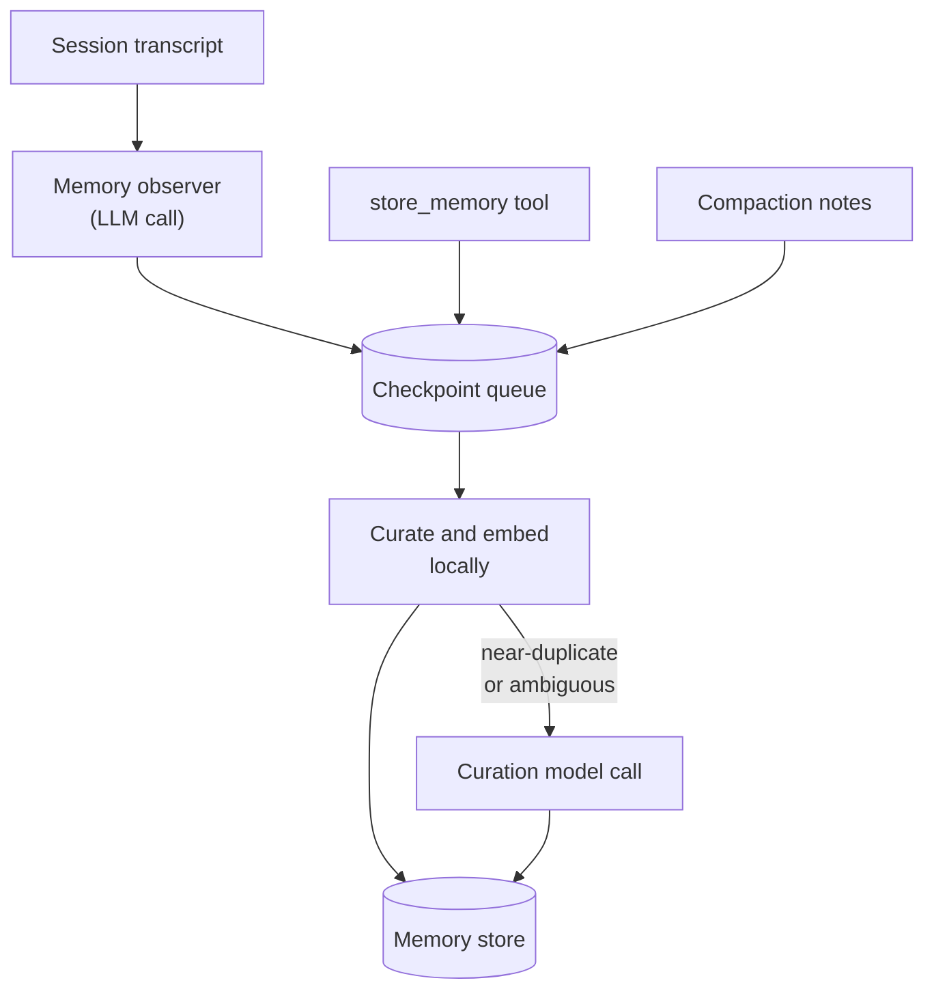
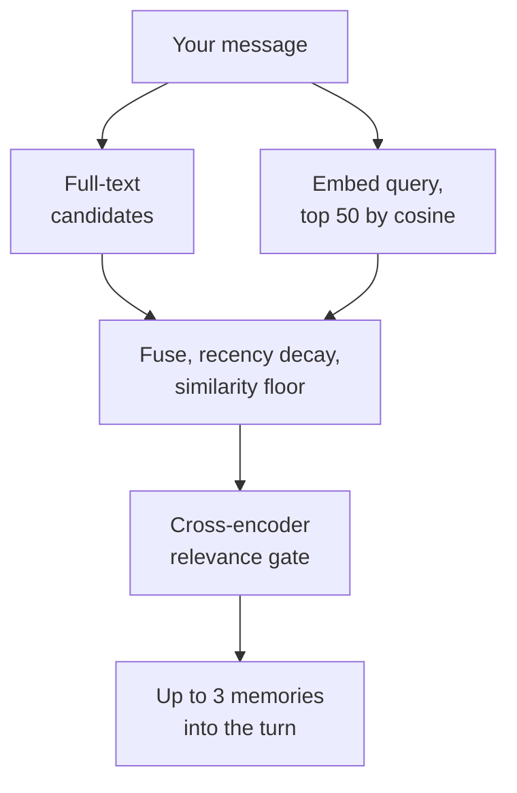

Agents that forget everything between conversations aren't useful for real work, and agents that make you tag and save context don't get used. netclaw sits between the two. A background memory observer watches each conversation, a curation pipeline decides what's worth keeping, and before every turn a recall step injects the few memories that actually bear on what you just said. Everything lives in one SQLite file, and since 0.27.0 the semantic search runs on your own CPU with two small ONNX models. If you're not familiar with how [sessions](/architecture/sessions/) work, start there.

The mental model is two paths that share one store. The write path is slow, asynchronous and uses an LLM sparingly. The read path is fast, local and gated hard, so most turns inject nothing at all.

Writing happens in the background. The memory observer's LLM call fires after 90 seconds idle, every 5 turns, and at passivation.



Reading happens on every turn, inside a 300 ms budget:



## What memory looks like in practice

### Conversation 1: Booking a flight

```
You:     I'm a United MileagePlus member and I need to book a flight
         to Amsterdam.

netclaw: What's your origin airport, and when do you need to travel?

You:     IAH. First week of October.

netclaw: Here are some United flights from Houston Intercontinental
         to Amsterdam departing October 1–7...
```

Once the conversation goes quiet, the memory observer (a companion actor running alongside the session) proposes three things worth keeping:

| What it stores | Memory class | Why |
|----------------|-------------|-----|
| You're a United MileagePlus member | Durable fact | Airline preference, useful indefinitely |
| Your usual origin airport is IAH | Durable fact | Travel pattern, useful indefinitely |
| You need a flight to Amsterdam in early October | Evidence | Specific task, expires after 30 days |

You didn't ask it to save any of this.

### Conversation 2: A week later

```
You:     I need to book a flight to Boston for next week.

netclaw: Here are some United flights from IAH to Boston departing
         next Monday through Friday. Want me to check MileagePlus
         award availability too?
```

The agent recalled your airline and home airport from durable memory without a tool call. The Amsterdam evidence is still stored, but it's a different task, so it didn't clear the relevance gate for a Boston question.

### Living documents: memory that updates over time

Not all memories are write-once. If you ask the agent to track RAM prices every week, it doesn't create a new memory each time. It updates the same document and keeps the history:

```
You:     Check DDR5 64GB kit prices on Newegg and update your
         price tracking memory.

netclaw: Updated the DDR5 price tracker. Current best: $142.99
         (down from $149.99 last week). I've added this week's
         data point to the tracking document.
```

Memory has two update patterns. **Merge-document** memories get revised and consolidated, like the price tracker. **Immutable-record** memories are append-only evidence, like "completed the database migration on May 2nd". The LLM picks the pattern from the content.

## How memories form

Formation happens outside your turn, so you never wait for it.

**Memory observer.** Each session has a companion actor that accumulates the transcript: your messages, assistant replies, tool call names, recalled memories and loaded skills. It makes a separate LLM call to distill that transcript into memory proposals when the session has been idle for 90 seconds (`Session.MemoryObserverIdleSeconds`), after every 5 completed turns (`Session.Tuning.MemoryDistillationTurnInterval`), and once more when an idle session shuts down. Information already shown as a recalled memory is excluded from new proposals.

**Other entry points.** The agent's `store_memory` tool queues a proposal directly. After a [compaction](/architecture/sessions/#compaction), the session also queues a checkpoint carrying the compaction summary. Subagents can't write memory themselves. They return structured findings to the parent session, which reviews them and queues only the accepted ones.

**Checkpoint queue.** Proposals land in the `memory_checkpoints` table, not in an in-memory queue. A background worker leases them, retries up to 5 times, and survives a daemon crash between observation and curation.

**Curation.** The worker applies rules first: pattern matching for project facts, milestones and preferences, fingerprint deduplication, and a block on anything that looks like a secret or credential. Then it embeds the proposal and looks up existing memories with similarity above 0.86 (up to 5). Similarity only nominates candidates. It never merges anything by itself. When there's a nominee, or the rules can't decide, a curation call to your Main model picks create, update, consolidate or skip. A merged body is validated against its sources before it's written, and if validation fails the new text is appended instead, so nothing gets dropped. A proposal that matches nothing already stored is created without an LLM call.

Put together, the memory-related calls that reach your model provider are the memory observer call per trigger, the curation call when a near-duplicate turns up or the rules can't decide, and the compaction notes call. Embedding and relevance scoring run locally and cost no provider tokens.

## Memory classes

| Class | Lifespan | Auto-recalled | Example |
|-------|----------|---------------|---------|
| **Durable fact** | Permanent | Yes, if it clears the gate | "Prefers TypeScript over JavaScript" |
| **Evidence** | 30 days | Yes, if it clears the gate | "Completed the database migration on May 2nd" |
| **Trace** | 72 hours | Never | Raw conversation logs |

Durable facts are what make the agent feel like it knows you. Evidence (work product, findings, completed tasks) matters for weeks but not forever. Traces are for debugging memory itself.

Expired evidence stays in the database but drops out of search results. The query layer filters it at read time, and no garbage collection runs.

## The knowledge graph

Memories hang off **anchors**: entities like projects, people, preferences, workflows and milestones. Anchors can be linked by edges, which makes a lightweight graph. The LLM manages it as it creates and updates memories.

That's what connects the dots across conversations. When the agent stores "uses PostgreSQL" as a durable fact anchored to your backend project, and later you ask about that project's infrastructure, the PostgreSQL fact comes along because the anchor links them.

## How recall works

Before each user turn, a retrieval coordinator runs a small [retrieval-augmented generation](https://en.wikipedia.org/wiki/Retrieval-augmented_generation) pipeline, all inside the daemon.

1. **Plan.** It tokenizes your message and recent context into a lexical query and anchor hints.
2. **Candidates.** SQLite FTS5 returns lexical matches. In parallel the query is embedded with the local model and up to 50 nearest vectors are fetched by cosine similarity. The two sets are merged.
3. **Rank.** Each candidate gets a fused score: 0.7 times cosine similarity, plus 0.3 times its squashed lexical score, plus a small prior for its memory class. That score is multiplied by a recency factor, `0.85 + 0.15 × 2^(-age/30 days)`, so old memories lose a little but never vanish on age alone.
4. **Floor.** A candidate whose vector is below the similarity floor (0.24 for the default model) is dropped. A memory with no vector yet, because it predates the backfill, can't be measured, so it skips the floor and competes on its lexical score. Records (the immutable-record class) have no embeddings by design, so they always compete on lexical score and don't count as a recall coverage gap.
5. **Gate.** The top candidates, at most 3 by default, go to a cross-encoder that reads the query and the memory together. Anything scoring below 0.02 is dropped.
6. **Inject.** What's left goes into the turn as a `[memory-recall]` block, capped at 2,000 characters. Zero survivors means no block at all, which is a healthy result and the common one.

The whole thing runs on a 300 ms budget, with 150 ms for embedding the query and 120 ms for the gate. If a stage runs out of time or a model isn't loaded, recall degrades to the stage before it instead of delaying your turn. With embeddings off or unavailable, recall is full-text only: the same query against the same store gives the same results every time.

The recalled block rides in the per-turn nudge, not the system prompt, so it doesn't break prompt caching. [Context structure](/architecture/context-structure/) shows where.

### Why the gate exists

The 0.27.0 release notes report this out-of-sample test on 450 real-traffic queries:

| Metric | Hybrid floor only | With the cross-encoder gate |
|--------|------------------:|----------------------------:|
| Correct zero-injection | 7.3% | 86.8% |
| Relevant recall retained | n/a | 98.3% |
| Mean injected items per turn | 2.538 | 0.251 |

The floor alone lets weakly related memories through nearly every turn. The gate cuts that to about one turn in four while keeping almost all the useful hits.

### The models

| | Embedder | Relevance gate |
|---|---|---|
| Model | `snowflake-arctic-embed-m-int8` | `ms-marco-minilm-l-6-v2` |
| Job | Turns text into a 768-dimension vector | Scores a query and a memory together |
| Size on disk | 110 MB | 23 MB |
| Runs | At write time, and on each recall query | Per candidate on recall |

Both are downloaded from huggingface.co on first daemon start into `~/.netclaw/models/`, checked against pinned SHA-256 hashes, and loaded in-process through ONNX Runtime. Vectors live in the `memory_embeddings` table, and the daemon keeps a brute-force index in memory. Expect roughly 480 MB resident with them loaded and about 235 MB without. The [memory configuration page](/configuration/memory/) has measured numbers, the offline procedure, and the switch to turn it all off.

## Audience scoping

netclaw classifies every session into a [trust tier](/architecture/design-philosophy/#lightweight-access-control-without-an-identity-provider) from its source channel: Personal, Team or Public. Memory respects the tiers:

- **Public** sessions have no memory access. No recall, no writes, no search. Memories authored by Public sessions are excluded from all audiences.
- **Team** and **Personal** sessions have full memory access, scoped by policy boundary.

Each memory carries the audience and boundary of the session that created it. A memory formed in a Personal session doesn't surface in a shared Team channel unless policy allows it.

## Compaction and memory

When a session's context fills up, [compaction](/architecture/sessions/#compaction) shrinks the history and a model call writes compaction notes about what was discarded. After the compaction is saved, those notes are queued as a `compaction-boundary` checkpoint and go through the same curation pipeline as everything else. That's the safety net: compaction can lose nuance, but durable memories persist independently of the conversation history.

## Explicit tools

The agent has four tools for direct memory management, available in Team and Personal sessions:

| Tool | Purpose |
|------|---------|
| `find_memories` | Search durable facts and current evidence, optionally including expired evidence |
| `get_memories` | Load the full content of specific memories by id |
| `store_memory` | Save a memory on request |
| `update_memory` | Edit a memory (find and replace, or full rewrite), supersede a record, or delete one |

Most of the time, automatic observation handles formation and automatic recall handles retrieval. The tools cover the gaps: correcting something the agent got wrong, or searching when recall injected nothing. If you say "that's wrong, I switched to Postgres last month", it finds the memory and edits it. To find, correct or remove a wrong memory yourself, see [fix a wrong memory](/configuration/memory/#fix-a-wrong-memory).

## Observability

Memory is invisible in normal use. To see what it's doing:

- **`netclaw status`** shows `memory: sqlite (healthy)` or degraded.
- **`netclaw stats`** shows how many memories were formed and recalled this process, the store's anchor, document, record and edge counts, and pending checkpoints.
- **`netclaw doctor`** checks the checkpoint backlog (warns above 25 pending), curation model health, embedding coverage and the relevance gate.
- **The daemon log** carries a `memory_retrieval_final` line per turn with how many candidates the floor and the gate dropped, and `memory_recall_*_degraded` lines when a stage was skipped.

## Configuration

Memory is on by default, and the defaults suit most installs. The settings that matter are `Memory.Enabled`, `Memory.Embeddings.Enabled`, `Memory.Embeddings.AutoDownload` and `Memory.AutoRecallMaxItems`. All of them are covered, with defaults, on [Memory and embeddings](/configuration/memory/).

## Limitations

- One machine, one SQLite file. There's no external vector database, and no remote embedding service to point at.
- The first start with embeddings on needs to reach huggingface.co, or the model files copied in beforehand.
- There's no `netclaw memory` command to list, export or delete memories. The agent's tools and the SQLite file are the routes.
- A memory edited through the agent is re-embedded as part of the edit. One edited directly in the SQLite file loses its vector until the next daemon start or `netclaw memory backfill-embeddings`.

## Related pages

- [Sessions and input model](/architecture/sessions/) - the lifecycle and compaction that feed memory
- [Context structure](/architecture/context-structure/) - where recalled memories sit in each turn
- [Memory and embeddings](/configuration/memory/) - configuration, resource cost, offline use, fixing a wrong memory
- [`netclaw memory`](/cli/memory/) - backfill vectors after an upgrade
- [Design philosophy](/architecture/design-philosophy/#automatic-memory-formation) - why memory belongs in core

## Resources

- [SQLite FTS5](https://www.sqlite.org/fts5.html) - the full-text engine behind lexical recall
- [ONNX Runtime](https://onnxruntime.ai/) - runs the embedding and relevance models
- [snowflake-arctic-embed-m](https://huggingface.co/Snowflake/snowflake-arctic-embed-m) - the embedding model netclaw ships as its default
- [Write-ahead logging](https://www.sqlite.org/wal.html) - how SQLite keeps the memory store durable
- [Akka.NET persistence](https://getakka.net/articles/persistence/event-sourcing.html) - journal and snapshot recovery behind the observer
