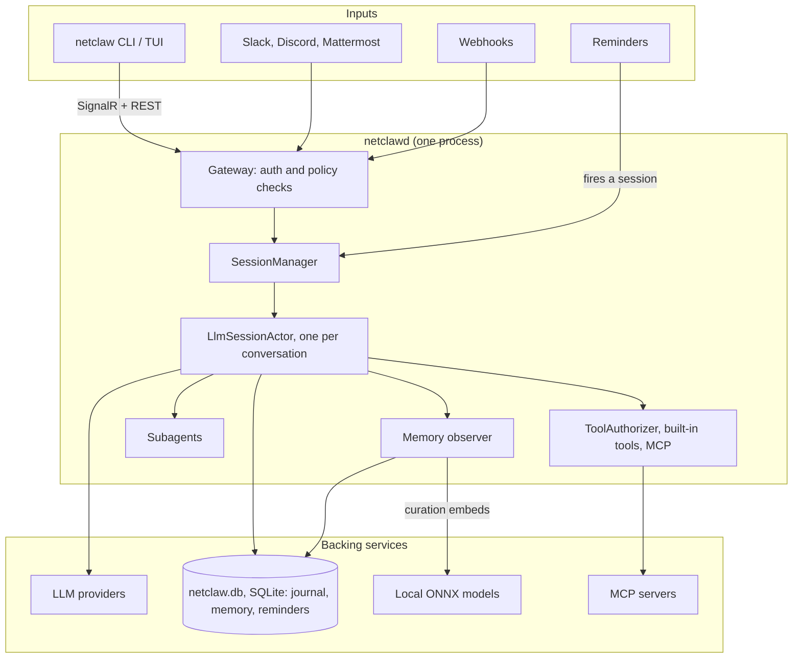

netclaw is a single-process .NET 10 application that runs as an always-on agent. It takes input from Slack, Discord, Mattermost, webhooks, timers and a local TUI, and treats all of them the same way: as messages routed into persistent conversation actors. One daemon owns everything that matters, and the rest of this page maps its parts.

Two binaries ship together: `netclawd` (the daemon) and `netclaw` (the CLI). The daemon holds the agent logic. The CLI is mostly a thin client that renders the daemon's output in a terminal, with a few commands (`memory`, most of `doctor`) that work straight on files, so they still run when the daemon is down.

## Two binaries

### `netclawd`: the daemon

The daemon is an ASP.NET Core application that owns the [Akka.NET](https://getakka.net/) actor system, LLM sessions, tool execution, the channel adapters (Slack, Discord, Mattermost), the SignalR hub, the REST API, and SQLite persistence. It binds to `http://127.0.0.1:5199` by default, and a PID file at `~/.netclaw/netclaw.pid` plus a lock file enforce one daemon per machine. To listen beyond loopback, see [exposure modes](/deployment/exposure-modes/).

### `netclaw`: the CLI

A Termina-based TUI with no actor system and no tool execution. It connects to the daemon over SignalR and renders what comes back. It also manages the daemon: `netclaw daemon start` and `netclaw daemon stop` run `netclawd` as a detached process.

The split matters. Restart the CLI without interrupting conversations. Keep the daemon in Docker and the CLI on your host, or run the CLI inside the container with `docker exec <container> netclaw <command>`, since the image ships both binaries. Talk to the same sessions from Slack instead of a terminal.

`netclaw status` reports daemon state, connectors, uptime and the current model.

## Communication

The CLI reaches the daemon over two protocols:

| Protocol | Path | Purpose |
|----------|------|---------|
| **SignalR** | `/hub/session` | Interactive sessions: create or attach to a session, send messages, answer approval prompts, stream output back |
| **REST** | `/api/*` | Everything without real-time delivery: health, stats, device pairing, MCP queries, shutdown |

The hub's methods are `CreateSession`, `EnsureSession`, `AttachSession`, `SendMessage` and `RespondToInteraction`. Output comes back as typed events on a stream. Remote clients authenticate with a device bearer token issued through [pairing](/guides/pairing-remote-devices/). A loopback request counts as the operator's own only when its `Host` is `localhost` or a loopback address and any `Origin` matches. Otherwise it gets a 401.

## Akka.NET internals

[Akka.NET](https://getakka.net/) is the concurrency and persistence layer. Every conversation is an actor, every channel adapter is an actor, and so are background jobs, reminders and tool approvals.

### Key actors

| Actor | Role |
|-------|------|
| `LlmSessionActor` | One per conversation thread. Persistent, with five phases: Recovering, Ready, Processing, Compacting, Passivating. See [sessions](/architecture/sessions/). |
| `SessionManager` | Routes messages to the right session actor with child-per-entity routing (no lookup table). |
| `SessionMemoryObserverActor` | A persistent child of each session. Watches the transcript and proposes memories when the session goes quiet. |
| `MemoryCurationActor` | Validates and deduplicates memory proposals. A background worker applies the same logic to the durable checkpoint queue. |
| `SubAgentActor` | Child of a session actor. Runs delegated work (research, code analysis, summarization) in the background while the session carries on. |
| `ReminderManagerActor` | Scheduled tasks, backed by Akka.Reminders and SQLite. |
| `BackgroundJobManagerActor` | Detached shell jobs, up to 5 at a time. |
| `ToolApprovalActor` | Holds approval requests until a human answers. |
| `PairingActor` | Issues pairing codes and device tokens for remote clients. |
| `ModelCapabilityActor` | Singleton that caches model capabilities at startup. |
| Channel actors | A gateway, conversation and thread-binding actor for each of Slack, Discord and Mattermost. |

### Why actors

Each conversation needs its own state, its own message queue and crash isolation from the others. Actors give you that without thread management. A session actor processes one turn at a time, journals its events to SQLite, and recovers its full history on restart. If one conversation crashes, the rest keep running.

Persistence uses [Akka.Persistence.Sql](https://getakka.net/articles/persistence/event-sourcing.html) with SQLite and [Google Protobuf](https://protobuf.dev/) serialization through `NetclawProtobufSerializer`. The journal records turns, accepted input, tool batches and their calls, approval requests and decisions, compaction, title changes and background job reaping. It's an event log for the session, not just a transcript.

## Three boundaries

Three logical boundaries divide the daemon, from the [runtime spec](https://github.com/netclaw-dev/netclaw/blob/dev/docs/spec/SPEC-001-runtime-boundaries.md).

At the edge, the **gateway** receives transport events (a Slack message, a webhook POST, CLI input), runs policy checks, and converts them to actor commands. Nothing reaches the session layer before policy runs.

The **session** layer owns conversation state, turn lifecycle, compaction and persistence. Sessions only broadcast outward. They don't know whether they're talking to Slack, Discord or the CLI.

**Subscribers** (channel adapters and UI clients) consume those broadcasts. They render output and nothing else, and they can't read actor internals or influence model behavior.

Data flows one way: the gateway sends commands to sessions, and sessions broadcast to subscribers. A policy error closes the gate.

## Everything is just input

A Slack message, a webhook POST, a timer, a CLI chat: each produces a message routed to a session actor with context-specific instructions. The actor doesn't know where it came from, and turns run identically regardless of source. Adding a channel adapter requires no changes to the session layer.

## Channel adapters

Slack, Discord and Mattermost adapters run inside the daemon as [hosted services](https://learn.microsoft.com/en-us/aspnet/core/fundamentals/host/hosted-services). They're in-process actors holding persistent connections to the platform APIs, not external bridges.

| Channel | Connection | Actors |
|---------|-----------|--------|
| **Slack** | [Socket Mode](https://api.slack.com/apis/socket-mode) via SlackNet | `SlackGatewayActor`, `SlackConversationActor`, `SlackThreadBindingActor` |
| **Discord** | WebSocket via Discord.Net | `DiscordGatewayActor`, `DiscordConversationActor`, `DiscordSessionBindingActor` |
| **Mattermost** | WebSocket and REST, with interactive actions posted back to the daemon | `MattermostGatewayActor`, `MattermostConversationActor`, `MattermostSessionBindingActor` |

An [Akka.Streams](https://getakka.net/articles/streams/introduction.html) `SessionPipeline` bridges channel adapters to the actor system. Setup for each is in the [channels section](/channels/slack/).

## LLM providers

netclaw uses [Microsoft.Extensions.AI](https://learn.microsoft.com/en-us/dotnet/ai/ai-extensions) (`IChatClient`) as the provider abstraction. Supported providers:

| Provider | Type key | Notes |
|----------|----------|-------|
| **Ollama** | `ollama` | Native integration, queries `/api/show` for capabilities. |
| **OpenRouter** | `openrouter` | Widest model catalog. |
| **Anthropic** | `anthropic` | Direct API. |
| **OpenAI** | `openai` | Direct API, OAuth or API key. |
| **GitHub Copilot** | `github-copilot` | OAuth device flow. Uses your Copilot subscription. |
| **Venice.ai** | `veniceai` | Privacy-focused, OpenAI-compatible API. |
| **DeepSeek** | `deepseek` | `deepseek-v4-*` models get a 1M context window and text-only limits from netclaw. |
| **OpenAI-compatible** | `openai-compatible` | Any self-hosted endpoint (llama.cpp, vLLM). The API key is optional. |

At startup the daemon works out each model's context window and input and output modalities. It asks the provider first, then falls back through the OpenRouter catalog and HuggingFace metadata, filling each field from the first source that knows it, and assumes text-only if nothing answers. See [Models](/configuration/models/) for configuration and [managed](/configuration/managed-providers/) or [self-hosted](/configuration/self-hosted-providers/) providers for setup.

## Session lifecycle

Each conversation thread maps to one persistent actor. The actor cycles between Ready and Processing, compacts when its context passes a threshold, and passivates when idle. [Sessions](/architecture/sessions/) covers the phases, the timeouts, compaction and what a session leaves on disk.

## Tool system

Tools are C# methods registered at compile time through a Roslyn incremental source generator, which produces the JSON schema and typed deserializers with no runtime reflection. `ToolRegistry` holds the catalog and `IToolExecutor` runs them.

Since 0.27.1 every tool call and every shell call goes through one `ToolAuthorizer`: the same authority and consent loop, so there's no second gate to drift out of sync. The older policy classes (`ToolAccessPolicy` for which tools exist, `ToolPathPolicy` for filesystem boundaries, `ShellCommandPolicy` for shell commands) still do the individual checks inside it. Feature gates hide the tools of a disabled subsystem (memory, search, skills, scheduling, subagents) from every audience. The deployment posture caps the audience of every call, including a sub-agent's, so a Team posture gives `netclaw chat` Team tools. See [the security model](/security/security-model/).

A session starts with a small core of tools and loads the rest on demand, so the prompt stays small. That's progressive disclosure. `search_tools` ranks its results by how many query words match, so a built-in tool like `list_reminders` turns up ahead of a shell command.

### MCP integration

External tool servers connect through the [Model Context Protocol](https://modelcontextprotocol.io/). `McpClientManager` handles the server lifecycle, including OAuth 2.1 flows and, since 0.27.0, pre-registered confidential clients with a stored client secret. Servers connect in parallel at startup. Sessions see server summaries until a tool is requested through `search_tools`. A server's prompts can be invoked as skills, and image, audio and resource results from MCP tools are delivered as files. See [MCP servers](/configuration/mcp-servers/).

## Supporting systems

The daemon keeps memory in `~/.netclaw/netclaw.db`: documents, records, a full-text index and, since 0.27.0, vectors. Two small ONNX models downloaded to `~/.netclaw/models/` embed memories and gate recall, entirely in-process. A background `MemoryCurationEngine` extracts, deduplicates and merges proposals. See the [memory model](/architecture/memory-model/).

**Skills** are markdown files that extend what the agent knows how to do. The built-in system skills ship inside the daemon binary and are restored on every start. Everything else comes from your own skills directory, operator-configured [skill feeds](/skills/skill-feeds/) and external sources, or from the agent itself through the `skill_manage` tool.

For delegated work, a session spawns a **subagent** as a child actor. Definitions live in `~/.netclaw/agents/*.md` with YAML frontmatter (built-ins: research-assistant, code-analyst, summarizer), and each run goes on until it gives a final reply, is cancelled or goes quiet for too long, with no fixed cap on tool rounds. `spawn_agent` returns a run ID at once. The run is recorded in the session journal, and its result arrives in a later turn as a notice that names a `result.md` file. See [custom subagents](/skills/custom-subagents/).

Search runs through Brave, DuckDuckGo or SearXNG backends. Images and attachments are normalized before they reach a model. Scheduled tasks go through `ReminderManagerActor`, covered in [Reminders](/configuration/reminders/).

## Configuration

Layered, with later sources winning:

1. `~/.netclaw/config/netclaw.json`: base config
2. `~/.netclaw/config/secrets.json`: encrypted credentials (ASP.NET Core Data Protection)
3. `NETCLAW_*` environment variables: highest priority

`ConfigWatcherService` watches `netclaw.json` with a 500 ms debounce. A valid change triggers a coordinated restart: close ingress, drain active sessions, persist state, restart in-process, then warm the active sessions back up. An invalid change is refused and the running daemon keeps its current configuration. Secrets and environment changes aren't watched, so those need a manual restart, and an OAuth token refresh writes `secrets.json` without causing one.

The drain stops each session at a safe point, such as the end of a tool batch, and tells the person in the chat. A turn stopped after its first tool batch resumes after the restart when nothing else is waiting. A running sub-agent parks and resumes too, which can add up to about 18 seconds to a graceful restart. A graceful stop of the whole daemon is still bounded to 30 seconds.

## Deployment

netclaw runs on Linux (x64 and arm64), Windows x64 with native PowerShell, and macOS on Apple Silicon. The installer downloads two archives per platform, `netclaw` and `netclawd`, as `.tar.gz` (`.zip` on Windows).

| Method | Guide |
|--------|-------|
| **systemd** (recommended for Linux) | [systemd service](/deployment/systemd/) |
| **Docker** | [Docker deployment](/deployment/docker/) |
| **Direct** | `netclaw daemon start` (detached process) |

The Docker image ships both binaries, with `netclaw` on the PATH, so `docker exec <container> netclaw status` works. For remote access beyond loopback, see [exposure modes](/deployment/exposure-modes/).

## Design principles

None of these are aspirational. They're constraints the codebase enforces.

1. **Gall's Law first.** Ship a simple working system before building a generalized framework.
2. **Actor transport boundary.** Channel adapters consume broadcasts through pub/sub and never drive model internals directly.
3. **Serialization boundary.** netclaw controls its own persistence schema and never persists framework-external chat types.
4. **Security boundary.** Default deny, explicit allow, fail closed. See the [security model](/security/security-model/).
5. **Everything is just input.** Every source (Slack, webhook, CLI, timer) produces a message routed to a session actor. No special-casing by channel.

## Limitations

- No clustering. One daemon, one machine, one actor system.
- SQLite is the only persistence backend. That's right for a single node and doesn't scale to multiple instances.
- Remote access works through exposure modes and paired devices, not through an identity provider. There's no per-user login.
- Binary updates need a daemon restart. There's no hot code reload.
- Local semantic memory loads about 129 MB of models and makes the daemon roughly twice the size (about 480 MB idle against about 235 MB) it'd be without them. Turn it off if the host can't spare the RAM.

## Related pages

- [Sessions and input model](/architecture/sessions/) - lifecycle, timeouts, compaction and storage
- [Memory model](/architecture/memory-model/) - how the daemon remembers across sessions
- [Context structure](/architecture/context-structure/) - what the model sees each turn
- [Security model](/security/security-model/) - audiences, approvals and the tool authorizer
- [Design philosophy](/architecture/design-philosophy/) - why it's built this way

## Resources

- [Akka.NET documentation](https://getakka.net/) - the actor framework behind netclaw's concurrency
- [Microsoft.Extensions.AI](https://learn.microsoft.com/en-us/dotnet/ai/ai-extensions) - the `IChatClient` abstraction for LLM providers
- [Model Context Protocol specification](https://modelcontextprotocol.io/) - the standard for external tool servers
- [SignalR documentation](https://learn.microsoft.com/en-us/aspnet/core/signalr/introduction) - real-time communication between the CLI and the daemon
- [SQLite documentation](https://www.sqlite.org/docs.html) - the persistence and memory backend
