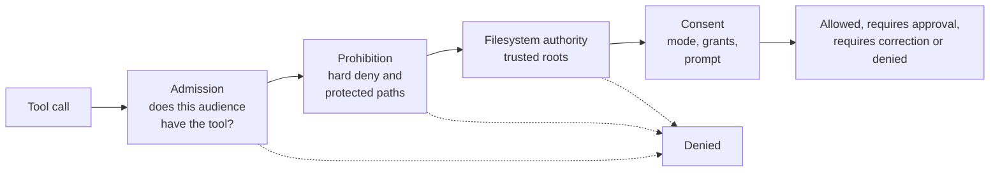

Netclaw gives an LLM shell access, file access and the ability to talk to external services. Without guardrails, that's a loaded weapon pointed at your infrastructure. The security architecture exists to make the agent useful without making it dangerous, and it's enforced from daemon startup with no extra setup.

The core bet is that explicit grants are safer than implicit restrictions. Rather than enumerate everything dangerous and block it, netclaw starts from zero permissions and asks you to opt in to each capability. We build up from nothing instead of poking holes in a wall.

This page is the design rationale. For what netclaw enforces and the exact lists, see the [Security model](/security/security-model/). For how prompts work, see [How tool approvals work](/security/approvals/).

## Design decisions

### Default-deny over default-allow

Most tools start permissive and add restrictions. Netclaw does the opposite. A fresh daemon with no config file binds loopback, disables shell, and gives channel traffic only basic file tools inside a session directory. Even the local TUI gets only those Public tools until a config sets a deployment posture. You build up from there.

Misconfiguration fails safe. Forget to add a tool grant and the tool is invisible. Mistype a channel ID and that channel gets nothing. Write a malformed tool list and the daemon refuses to start.

### Audience as the trust primitive

Per-user ACLs need identity infrastructure that most self-hosted deployments don't have. Netclaw classifies trust by where a message came from instead. A message from the TUI is from the operator at the machine. A message from Slack could be anyone in the workspace. An unknown source gets the least trust.

```
Personal  >  Team  >  Public
```

This maps to how people deploy: you trust yourself on your own machine, partly trust coworkers in a channel, and don't trust unknown sources. Each channel or DM is assigned an audience individually, so one platform can span tiers, with DMs as Personal and a shared ops channel as Team. See [Audiences](/security/security-model/#trust-audiences) for how audiences are assigned.

The deployment posture is a ceiling on top of that. The audience that every tool decision uses, for a turn and for any sub-agent or routed skill it starts, is the narrower of the posture's audience and the message's source audience. A Team posture therefore runs the TUI with Team tools, which is the point of choosing it: that choice sets the baseline for what the agent can do wherever the message came from.

### Four layers, not one

Every tool call goes through one authorizer. It applies a single ordered list of rules, and the first rule with an answer wins. Conceptually the rules fall into four layers, and a call has to get through all of them.



The details those layers cover include the rule that Personal file reads reach as far as writes do, a private temp folder for each session, checks on redirects in compound shell commands, and glob checks that follow symlinked folders. The first three layers can only deny, and nothing the operator answers at a prompt reaches back through them. Consent is the only layer that asks a person, and it has two outcomes beyond allow and deny: it can prompt, or it can hand the agent advice so the agent re-authors the call. Putting prohibition before consent is the point. A saved "Always" grant can never cover a hard-denied command or a protected path, because those rules run first.

Having one authorizer rather than four independent checks matters for a second reason. Built-in tools, MCP tools, shell, subagents and unattended runs all take the same path, so a rule can't be bypassed by finding the tool that skipped a check. The exact order is in [Layers in order](/security/security-model/#layers-in-order).

### Policy before dispatch

Inbound message ACL checks run at the gateway, before a message reaches the session layer. Tool policy runs in the session's tool executor, before any tool fires. The [three-boundary design](/architecture/overview/#three-boundaries) (gateway, session, subscriber) makes that structural: the gateway is the only way in for messages, and the tool executor is the only way to run a tool.

### Human-in-the-loop as a layer, not a crutch

Approval is the last layer, after hard denies and access grants have already filtered. The human only sees requests that are permitted but risky. You're not approving every `ls`. Reviewed read-only commands never prompt, and an answer of "Always" turns a one-off decision into a saved grant on a phrase, so `git push` is approved once rather than every time.

Prompts are how you build a policy, not the policy itself. When they keep coming, change a mode or a grant. [Reduce or turn off approval prompts](/guides/reduce-approval-prompts/) says how.

## Signals on every message

Every inbound message carries four signals:

| Signal | Source | Describes |
|--------|--------|-----------|
| Principal classification | Channel adapter | Who is speaking, such as an operator, a trusted internal user, an untrusted external user or verified automation |
| Transport authenticity | Connection type | Whether the sender can be verified: local process, verified, unverified |
| Payload taint | Content origin | Where the data came from: trusted, community, public |
| Audience | Channel type or configuration | What permission set applies |

The audience resolves the permission set. The other signals describe the turn and travel with it.

## MCP security: two-gate model

External tool servers connecting over the [Model Context Protocol](https://modelcontextprotocol.io/) are gated twice.

1. **Server gate.** The server must be reachable for the audience: `AllowedMcpServers` for Team and Public, everything for Personal.
2. **Tool gate.** If per-tool grants exist for the server (`McpServerToolGrants`), only the listed tools are visible. With no entry for the server, all its tools are.

Approval modes add a third dimension: each server and tool can be `Auto`, `Approval` or `Deny` per audience. `netclaw mcp add` writes locked-down defaults for Team and Public and an open default for Personal. See [MCP tool permissions](/guides/mcp-tool-permissions/).

Netclaw doesn't load MCP tools into the model's context until the model searches for them with `search_tools`. Granted but unused tools don't consume context or influence behavior.

## Self-configuration boundaries

The agent can change its own personality, instructions, reminders and project registry. It can't change security policy. Writes to the config directory are blocked by the path policy for every tool and every command form, so ACL rules, exposure mode, tool grants and audience mappings are read-only from the agent's side. Reminder tools are scoped to the caller's audience, so a Team session can't manage a Personal reminder.

## Threat model scope

What the model protects against:

- The LLM deciding to run destructive commands
- Prompt injection through channel messages attempting privilege escalation
- Overly broad tool access from misconfiguration
- Credential leakage through command output
- Unauthorized network exposure

What it doesn't protect against:

- A malicious operator with direct machine access
- Anything else the agent can read as the OS user. Agent tools are denied the common credential folders (`~/.ssh`, `~/.aws`, `~/.kube` and similar), but other files your user can read are open to it, and a command you approve still runs with your credentials
- A granted command doing more than its name suggests. Approvals aren't a sandbox
- Side-channel attacks against the LLM provider's API
- Denial of service against the daemon
- Vulnerabilities in third-party MCP servers. Netclaw gates access, not behavior

The second and third items are why the [Security model](/security/security-model/#what-netclaw-doesnt-protect-against) tells you to run netclaw as a separate OS user or in a container when the machine holds other credentials. A kernel sandbox for shell commands is planned and tracked in [netclaw-dev/netclaw#2343](https://github.com/netclaw-dev/netclaw/issues/2343).

## Related pages

- [Security model](/security/security-model/) - audiences, the order of checks, protected paths and the exact lists
- [How tool approvals work](/security/approvals/) - modes, outcomes, grants and prompts
- [Hardening](/security/hardening/) - production lockdown beyond the defaults
- [Architecture overview](/architecture/overview/) - the three-boundary design behind policy-before-dispatch
- [`netclaw doctor`](/cli/doctor/) - verify what's enforced at runtime

## Resources

- [OWASP LLM Top 10](https://genai.owasp.org/llm-top-10/) - the attack taxonomy the model is designed against
- [NIST AI Risk Management Framework](https://www.nist.gov/itl/ai-risk-management-framework) - federal guidance on AI risk management
- [Principle of least privilege (NIST)](https://csrc.nist.gov/glossary/term/least_privilege) - the philosophy behind default-deny
- [Defense in depth (NIST)](https://csrc.nist.gov/glossary/term/defense_in_depth) - the layered model behind the authorizer's rule order
