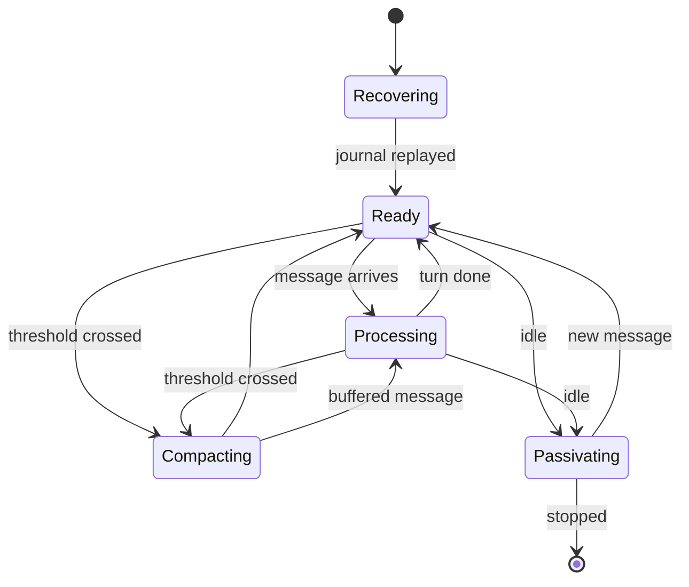

Every conversation in netclaw is a session. One Slack thread, one Discord thread, one Mattermost thread, one CLI chat: each maps to a single persistent [actor](https://en.wikipedia.org/wiki/Actor_model) that owns the conversation's state, processes one turn at a time, and survives daemon restarts. The session doesn't know or care where its messages come from, and that's the foundation everything else builds on.

A session has a few simple obligations. It accepts input, runs a turn, keeps its history from outgrowing the model's context window, and shuts itself down when nobody's talking. The rest of this page is those four things in detail, plus the files a session leaves on disk.

## Session identity

A session's identity comes from its channel and thread. In Slack the key is `{channelId}/{threadTs}`. Discord uses a channel-and-thread mapping, Mattermost binds a channel and a root post, and the CLI generates its own id when you start a chat.

The mapping is 1:1 on purpose. One thread, one session, one actor. There's no shared state between conversations and no global context leaking between users. If a session actor crashes, the rest keep running.

The `SessionManager` routes messages with child-per-entity routing: each session is a child actor created on demand and keyed by session id. There's no lookup table. The actor hierarchy is the routing table.

## Everything is just input

Slack messages, Discord messages, Mattermost posts, webhook POSTs, scheduled reminders and CLI chat input all enter through different adapters and produce the same command: a `SendUserMessage` routed to a session actor. The turn runs the same way regardless of source.

```
┌───────────────┐
│  Slack        │──┐
├───────────────┤  │
│  Discord      │──┤
├───────────────┤  │    ┌──────────┐    ┌─────────────────┐
│  Mattermost   │──┼───▸│  Gateway │───▸│  Session actor  │
├───────────────┤  │    └──────────┘    └─────────────────┘
│  Webhook      │──┤         ▲
├───────────────┤  │         │ policy checks
│  CLI / TUI    │──┘         │ before dispatch
└───────────────┘
```

Channel adapters run inside the daemon as hosted services: in-process actors holding persistent connections to platform APIs. Adding a channel means writing a new adapter. The session layer, compaction, the tool system and the security model stay untouched.

## Lifecycle

A session moves through five phases. The actor validates every transition, and an illegal one throws instead of falling back silently.



| Phase | What's happening |
|-------|------------------|
| **Recovering** | Journal replay and snapshot recovery. The actor rebuilds state before it accepts a message. |
| **Ready** | Accepting messages, with the idle timer ticking. |
| **Processing** | An LLM call or tool execution is in flight. Incoming messages are buffered, and [who joins the turn](#who-joins-a-turn) depends on who sent them. One turn at a time, always. |
| **Compacting** | The context window is getting full and the session is shrinking its history. Messages are buffered, as in Processing. |
| **Passivating** | The session is winding down: a final memory distillation (5-second grace period), a snapshot, then stop. A new message during passivation aborts it and returns to Ready. |

## What ends or stalls a turn

A turn ends when the model finishes, a timeout or watchdog fires, the daemon stops or drains, the [loop guard](#loop-guard) stops it, or a person's message ends an automation turn. A reply cut off at the output limit fails the turn: nothing cut off is posted or stored, and the error category is `ModelBehavior`. A model call that streams only thinking stops after three times `Session.NoProgressTimeoutSeconds`, which is 60 minutes by default. There's no ceiling on tool rounds. The timeouts exist because a hung provider shouldn't hold a session in Processing forever. All of them live under `Session` in `netclaw.json`, in seconds, and the [configuration reference](/configuration/reference/) lists every one.

| Setting | Default | What it bounds |
|---------|---------|----------------|
| `Session.PrefillTimeoutSeconds` | 1800 | Wait for the first token. Covers queueing and prompt prefill, which can legitimately take minutes on self-hosted backends. |
| `Session.FirstTokenTimeoutSeconds` | 600 | Silence between streaming tokens once the first has arrived. |
| `Session.NoProgressTimeoutSeconds` | 1200 | Time without real output. A backend that sends keepalives but no tokens still gets cut off. |
| `Session.ToolExecutionTimeoutSeconds` | 90 | One tool call. It must produce its first result in this time, and each streamed item resets the clock. |
| `Session.MaxToolIterationsPerTurn` | 60 | Legacy. It still binds, but nothing enforces it, so a turn that keeps doing new work can run past 60 rounds. |
| `Session.SidecarLlmTimeoutSeconds` | 90 | Background calls: title generation, memory distillation, compaction notes. |
| `Session.TurnLlmTimeoutSeconds` | 180 | Fallback. Setting it away from 180 without a `FirstTokenTimeoutSeconds` makes it the silence limit between tokens. |
| `Session.IdleTimeout` | `01:00:00` | Time before an idle session passivates. `00:00:00` disables passivation. |

A watchdog timeout fails the turn with a timeout error and the session returns to Ready, so the next message works. A slow 27B model behind a busy llama.cpp server is the usual case for raising the first two. An approval prompt isn't on this list because approvals don't time out.

### Loop guard

A model that repeats itself gets corrected before it burns the turn:

- **Repeated calls.** After two equal rounds, netclaw refuses the next identical call and returns a correction. The first four refused repeats get a nudge, the fifth a stronger one, and at the sixth the turn ends quietly with the model's text. The person sees no error.
- **Failed calls.** The guard also counts failed calls across different tools since the last batch that held a success. The model gets a nudge naming the repeated cause at a weighted score of 4 and a stronger one at 6. At 8, the next response that asks for tools ends the turn quietly. One success in a batch resets the count. Sub-agent runs use the same guard.

Only a new turn or new person input resets the counts.

### Who joins a turn

Each input runs under its own sender's authority, and a turn keeps the authority it started with.

- A new message from the same person joins the active turn at the next tool-batch boundary.
- A message from another person waits for its own turn.
- An automated input (a reminder, a job result, a webhook or a child notice) waits for its own turn, and it no longer closes an open approval prompt.
- When the operator or a trusted person writes during an automation turn, that turn ends after its current tool batch and the person's turn starts next. Its first model call carries a note that the automated turn stopped unfinished. An interrupted reminder records success and doesn't run its remaining steps. A message from an untrusted external person never ends a turn and waits.

## Multi-subscriber delivery

Several clients can attach to one session at once. Start a conversation in Slack, then attach from the CLI to watch tool calls and token usage live. Each subscriber gets its own filtered view.

Subscribers join with an `OutputFilter` bitmask:

| Filter | What it includes |
|--------|-----------------|
| **Text** | Final assembled assistant replies |
| **TextStreaming** | Incremental token deltas |
| **Thinking** | Reasoning tokens |
| **ToolCalls** | Tool call requests and results |
| **Usage** | Token counts and context window use |
| **Files** | Attachments produced by the model or tools |
| **ProcessingState** | Busy and idle state, for typing indicators |

Lifecycle messages (turn completed, title changes, errors, compaction notices) always arrive regardless of the filter. When a subscriber disconnects, the actor notices through a death watch and drops it. The conversation doesn't notice.

## Compaction

Sessions can run for days. Without compaction the [context window](https://platform.openai.com/docs/models) fills and the model loses its earlier context. Compaction starts when input tokens pass a fraction of the model's context window: `Session.Tuning.CompactionThreshold`, 0.75 by default.

It runs in order:

1. **Clear tool results.** Old tool output is replaced with placeholders, keeping the 3 most recent tool results in full (`KeepRecentToolResults`). No LLM call.
2. **Extractive reduction.** The oldest messages are dropped, keeping the most recent 6 (`KeepRecentMessages`). If what's left is still more than half the context window, the keep count is halved, down to a minimum of 2.
3. **Compaction notes.** One best-effort LLM call, on the Compaction model and failing over to the Fallback model when one is configured, reads the discarded messages and writes notes, which are inserted as a user-role message ahead of the kept ones. If the call fails or returns nothing, the extractive result stands.

Tool calls stay paired with their results. After compaction the session saves a snapshot, resets its token counter, queues the notes as a [memory](/architecture/memory-model/#compaction-and-memory) checkpoint, and returns to Ready, or to Processing if messages are waiting. The static context layers are rendered again on the next call, as [context structure](/architecture/context-structure/) explains.

## Storage on disk

New sessions get a versioned storage envelope under `~/.netclaw/sessions/<id>-<hash>/`. Directories appear as they're needed:

| Path | What it's for |
|------|---------------|
| `workspace/` | The session's working directory (`session_dir` in its context) |
| `attachment-staging/` | Untrusted uploads, before they're copied into the workspace |
| `artifacts/` | Outputs the user or parent session should keep |
| `tmp/` | Windows only. On Linux and macOS the temp folder is `/tmp/netclaw-<uid>/<key>/p`, outside the envelope and cleaned up by the OS, not when the session ends. netclaw sets `TMPDIR`, `TMP` and `TEMP` for child processes to point at it. Keep anything that must last in `artifacts/`. |
| `worktrees/` | Git worktrees. The agent adds one with `git worktree add`, then calls `set_working_directory`. |
| `logs/session.log` | The log for the run. Tool-call arguments are redacted, and a long string such as a file body shows as a length and hash |
| `subagents/<run-id>/` | The same layout for each subagent run, with its own `artifacts/` and `logs/`. It also holds `task.md` (the agent, requester and brief), `result.md` (written when the run ends) and, for a reply cut off at the output limit, `artifacts/truncated-output.md` |

Sessions that existed before 0.27.0 keep their old paths. netclaw doesn't move or rename their files.

The database stores each session's folder path. If you move or restore the data directory somewhere else, netclaw re-roots the stored path onto the current `sessions/` directory and logs one warning naming the old and new path.

:::caution
A pre-0.27 binary can't resume a session that has a versioned storage binding. If you downgrade, sessions created under 0.27 or later won't resume. See [Upgrade netclaw](/guides/upgrading/) before moving backward, and [Data directory layout](/reference/data-directory/) for the full tree.
:::

## Recovery and restart

The session journal lives in SQLite through [Akka.Persistence](https://getakka.net/articles/persistence/event-sourcing.html). It records more than turns: accepted input and who sent it, tool batches and their calls, tool approval requests and decisions, sub-agent runs and parked consent requests, compaction, title changes, and background job reaping. A journal or snapshot write that waits on SQLite times out at the connection's `Default Timeout` plus 10 seconds, and a failed save during a turn posts an error that says some actions may already have run. Snapshots are taken every 20 events and after every compaction.

Recovery is automatic. When a session starts, from a restart, a crash or a lazy activation, it replays its journal from the latest snapshot and goes to Ready. Accepted input is journaled before it's acknowledged, so a crash doesn't lose a message you've been told arrived.

Restarts come in two kinds. When you edit `netclaw.json`, the daemon drains active sessions, saves a manifest of them, restarts in-process, and warms those sessions back up before normal traffic resumes. A drain stops a tool loop at the next safe point and tells the person ("stopping" for `netclaw daemon stop`, "restarting" otherwise). A turn that stopped after its first tool batch resumes by itself after the restart, as long as no text reached the person, nothing else is waiting and every call has a result. Otherwise the person gets the stop notice. A graceful stop of the whole daemon is bounded to 30 seconds. Sessions that were idle stay cold and recover when someone talks to them.

A running sub-agent parks and resumes under the original requester's authority. One that can't park in time ends as `owner_restarted`, and its tools don't run again. A graceful restart with an active child can take about 18 seconds longer.

## Passivation, idle behavior and background work

Passivation keeps the daemon's footprint bounded. After `Session.IdleTimeout` with nothing happening, the session distills memory one last time, takes a snapshot and stops. A new message during the 5-second grace period cancels it.

Three things change the picture:

- **Running background jobs defer it.** A session with a live background job stays resident. Once the job is reaped or finished, the next idle timeout passivates it.
- **Subscribers don't.** A client attached to an idle session doesn't keep it alive. The channel binding stays subscribed until the session commits to stop, then drains its output and shuts down with it.
- **Pending approvals don't.** Approval state is journaled, so an idle session waiting on a person passivates, and the answer rehydrates it and resumes the parked tool batch.
- **Running sub-agents do.** A session with a live or unreported child run stays resident. A child parked on a consent request doesn't hold it, because the request is in the run record and a click wakes the session.

[Background jobs](/reference/tools/) (`shell_execute` with background mode) belong to the session that started them, and passivation kills any that are still running. They don't survive a daemon restart either. The next time that session wakes, it sees the job listed as reaped, with its output log still readable. Work that has to outlive the conversation belongs in a [reminder](/configuration/reminders/).

A session can also delegate to a [subagent](/skills/custom-subagents/): a child actor that runs one task in the background and never talks to the user. `spawn_agent` returns a run ID at once, the result arrives in a later turn as a notice that names `result.md`, and `check_agent_run` reads status or cancels. The child can't call `spawn_agent`, `check_agent_run` or `attach_file`, and can't write memory directly.

## Related pages

- [Architecture overview](/architecture/overview/) - the daemon, the actor system and the boundaries between them
- [Context structure](/architecture/context-structure/) - the layers each turn assembles, and how they're ordered for caching
- [Memory model](/architecture/memory-model/) - how a session's transcript becomes memories
- [`netclaw sessions`](/cli/sessions/) - list and resume sessions from the CLI
- [Configuration reference](/configuration/reference/) - every `Session` setting

## Resources

- [Actor model](https://en.wikipedia.org/wiki/Actor_model) - the concurrency model behind session actors
- [Akka.NET persistence](https://getakka.net/articles/persistence/event-sourcing.html) - journal and snapshot recovery
- [SQLite](https://www.sqlite.org/docs.html) - the persistence backend
- [Slack Socket Mode](https://api.slack.com/apis/socket-mode) - how the Slack adapter connects
- [Discord.Net](https://discordnet.dev/) - the .NET library behind the Discord adapter
