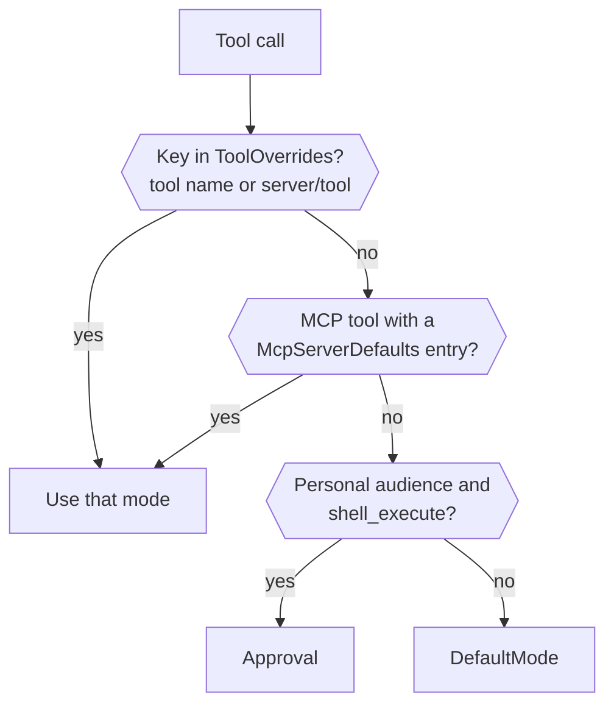
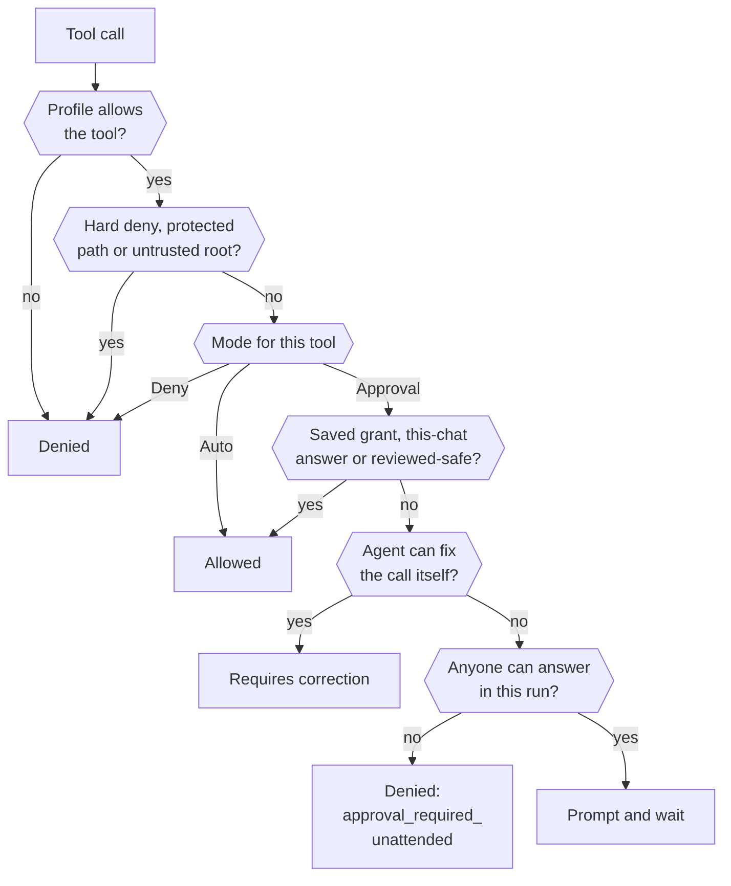

Every tool call the agent makes goes through one authorizer before it runs. The authorizer reads the call, the [audience](/security/security-model/#trust-audiences) it came from and your configuration, then returns one of four outcomes. Most calls are allowed without you seeing anything. A few reach you as a prompt in Slack, Discord, Mattermost, the TUI or the web client, and the call waits until you answer.

Three things decide whether a call prompts: a **mode** you set per audience and per tool, the **grants** you've already saved, and a built-in catalog of reviewed read-only commands that never prompt. Hard-deny rules and protected paths sit above all three. No mode, grant or answer can override them.

This page explains the model. To stop a prompt, see [Reduce or turn off approval prompts](/guides/reduce-approval-prompts/). For the commands that manage saved grants, see [`netclaw approvals`](/cli/approvals/).

## The four outcomes

| Outcome | What happens |
|---------|--------------|
| Allowed | The tool runs. |
| Requires approval | The channel shows a prompt and the call waits for an answer. |
| Requires correction | The agent gets advice and sends a different call. You see no prompt and nothing runs. |
| Denied | The tool doesn't run, and no answer changes that. |

A correction is the one most people haven't met. It's what you get when the call is fixable, such as a command over 900 characters that can't be shown in full on every channel, a write that belongs in the managed temporary directory, or an unquoted word the parser can't prove safe. A correction is sent only when the agent can follow it. A word whose value only exists at run time, such as `git $(echo status) origin` or `[ -n "$FOO" ]`, gets a one-time prompt instead. The agent rewrites the call and the new call goes through the authorizer from the top.

## Modes and where you set them

Each audience has an `ApprovalPolicy` that gives every tool one of three modes:

| Mode | Behavior |
|------|----------|
| `Auto` | No prompt. Hard deny, path checks and corrections still apply. |
| `Approval` | Netclaw prompts unless a saved grant, a this-chat answer or the reviewed-safe catalog covers the call. |
| `Deny` | The call is always blocked and nothing is offered. |

The policy lives at `Tools.AudienceProfiles.<Personal|Team|Public>.ApprovalPolicy` in `~/.netclaw/config/netclaw.json`:

| Key | What it sets |
|-----|--------------|
| `DefaultMode` | The mode for any tool without a more specific entry. Defaults to `Auto`. |
| `ToolOverrides` | A mode per tool, keyed by tool name (`shell_execute`) or `server/tool` (or `server__tool`) for an MCP tool. |
| `McpServerDefaults` | A mode for every tool of one MCP server, including tools discovered later. |

Keys match without regard to letter case, so `"File_Write": "Deny"` works. If two keys differ only by case, the stricter mode wins. A key that contains a colon (such as `file_write:control-plane`) or has no value is ignored, and the tool keeps the audience default. The daemon logs a warning at startup. `netclaw doctor` reports a colon key as an error and a key with no value as a warning. Before 0.28.0 a colon key set the whole tool to `Auto` instead ([GHSA-85pr-m799-g776](https://github.com/netclaw-dev/netclaw/security/advisories/GHSA-85pr-m799-g776)), so on an older install remove every `ToolOverrides` key that contains a colon.

Without any policy, Personal prompts for `shell_execute` and every other tool is `Auto`. Writes under `~/.netclaw/config/` aren't a prompt case at all: the path policy denies them before modes are read, and no override or grant changes that. Team and Public can't use shell at all. `netclaw mcp add` seeds each new MCP server with `Auto` for Personal, `Approval` for Team and `Deny` for Public.

### How netclaw picks the mode for a call



The third step is why `DefaultMode: "Auto"` doesn't silence shell on Personal. The fail-closed check runs before `DefaultMode` is read, so only a `shell_execute` entry (in any letter case) turns the prompt off.

## Why did this call prompt?

Follow the call from the top. The first box that answers "no" or "yes" with an outcome ends the walk.



This is the simplified order. The exact rule list lives in the product's [tool authorization architecture](https://github.com/netclaw-dev/netclaw/blob/dev/docs/architecture/tool-authorization.md). For a shell call, "covered" is judged per command: in `git pull && make build`, each command needs its own coverage, and the prompt names only the ones that remain.

To see which box a specific call stopped at, read the [policy trace](#see-why-a-call-prompted) in the daemon log.

## What each answer does

The prompt offers up to six options. Every client shows the same labels: Slack, Discord and Mattermost render them as buttons or lettered replies, and the TUI and web client show an inline list. In the TUI, pick with Up and Down and confirm with Enter. Esc is the same as Deny, and `Ctrl+O` shows the full command.

| Option | Saved? | Effect |
|--------|--------|--------|
| Once | No | The exact blocked call runs once. |
| This chat | In memory only | The phrase is allowed for the rest of this session. It's gone when the session ends. |
| Always here | `tool-approvals.json` | A grant for the folder the command works on, and everything under it. Shell only. [Which folder that is](#what-always-here-covers) depends on the command. |
| This repository | `tool-approvals.json` | A grant for one Git repository and its registered worktrees. Shell only, and only when every command resolves to one registered repository. |
| Always anywhere | `tool-approvals.json` | A global grant for the phrase. For an MCP tool the label reads **Always allow this tool**. |
| Deny | No | This call doesn't run. Netclaw doesn't remember the refusal. The agent is told you declined, to try no other route to the same goal, and to ask you how to continue. |

Here's the prompt for a `push` to a Git repository in the TUI, where all six options are on offer.


The status bar swaps to the pick-and-confirm keys while the prompt waits, and `Ctrl+O` expands a command that doesn't fit.

Mattermost without a callback URL shows the same six choices as a lettered text reply, which is what this capture is.


Slack and Discord render the same choices as buttons, and so does Mattermost once a callback URL is set. You get six only inside a Git repository. A command run elsewhere, or by a reminder, offers five because **This repository** drops out.

After an approved call, netclaw adds one line to the tool result the model reads: `[approval: once]`, `[approval: this chat only]`, `[approval: always in this folder]`, `[approval: always in this repo]` or `[approval: always anywhere]`.

A saved grant belongs to one audience and one tool. A grant for `shell_execute` under Personal never covers a Team call and never covers another tool. For shell, the grant is a phrase of command words: a phrase of two or more words (`git push`) covers those words plus any later arguments, and a one-word phrase (`gh`) covers only the program, so `gh` doesn't cover `gh pr view`. A shell grant also records the Bash variable assignments the command depends on. A changed value doesn't match the old grant and prompts again. A **Once** answer covers the exact command text it was given for, including after a restart.

### What Always here covers

The saved folder comes from the paths the command names, not from where you were standing:

- **A path whose last name looks like a file** (it has an extension or starts with a dot) saves the parent folder. Approving `touch /srv/app/new.txt` covers `/srv/app`, so `touch /srv/app/other.log` and `touch /srv/app/sub/x.txt` run without a prompt.
- **Any other path** saves the path itself. Approving `touch /srv/app/notes` covers `/srv/app/notes` and what's under it, so `touch /srv/app/other` prompts again. The same goes for a directory argument such as `chmod 600 /srv/app/sub` or a path that ends in `/`.
- **No path in the command** (`curl --version`) saves the working directory.

A grant never covers a sibling folder or the parent. Netclaw decides from the spelling of the name and never looks at the disk, so it can't tell that `notes` is a file. If an Always here grant doesn't stick, check which of these your command matched with `netclaw approvals list`.

### Why you sometimes see fewer options

| You see | Because |
|---------|---------|
| Only Once and Deny | The parser can't prove a reusable phrase for an uncovered command, or a `..` in a shell path leaves a symlink. A command like `rm "$f"` where the loop values only exist at run time, a word built at run time such as `git $(echo status) origin` and `[ -n "$FOO" ]` are the usual causes. No grant covers these. |
| No Always here | The tool isn't shell, the directory is too shallow (`/` or `/etc`), or it's a session-owned directory. A TUI chat starts in a session directory, so a command with no path there offers no Always here. |
| No This repository | The call's commands don't all resolve to one registered Git repository, or the checkout uses `--separate-git-dir`. |
| Only Once and Deny, again | The agent retried a write under `/tmp` after a correction told it to use the managed temporary directory. |

Only the person who started the request can answer a prompt, unless the request came from verified automation. A prompt never times out. While the session is live, a new message in the thread queues behind the prompt and doesn't dismiss it, so the way to unstick a waiting call is to answer it. If the daemon restarts or the session goes idle first, a new message abandons the waiting call. The daemon re-issues the prompt after a restart and a chat channel may still show it. The TUI doesn't redisplay it, so answer from the channel or send a new message. A sub-agent that needs consent parks. The parent gets one notice and pauses, and you answer on the prompt's buttons because a text reply like "A" resolves nothing. The park is saved in the run record, so a click after a restart still resumes the child. A prompt that nothing can answer any more (the child was cancelled or ended, or the channel can't show it) is redrawn without buttons and with the reason. On Mattermost, a sub-agent's prompt needs a `CallbackUrl`. Without one, netclaw refuses the request.

## What never prompts

Some calls skip the prompt even in `Approval` mode.

- **Reviewed-safe catalog.** Diagnostic commands like `ls`, `cat`, `grep`, `rg`, `jq`, `ps`, `git status`, `git log`, `git diff` and `gh pr view`. The catalog ships with the daemon and the agent can't extend it. It never includes `git push`, `rm`, `sed`, `find`, `env`, `curl` or `sudo`. It matches command words, not flags: `git branch` is listed, so `git branch -D old` also runs without a prompt.
- **Output commands.** `echo`, `printf`, `:`, `true` and `false`.
- **Commands that run no program.** A bare assignment (`FOO=bar`) or a lone redirect (`> notes.txt`) needs no approval of its own. A redirect on another command, as in `echo hi > notes.txt`, gets the same decision as a `file_write` to that path, so on Personal it runs, and a path in a protected location is denied. That includes a redirect on a group or subshell. A redirect target that netclaw can't work out is denied (`shell_redirect_unproved`).
- **Quoted heredocs.** `cat <<'EOF'` with fixed text runs. The text is data. A program that reads it from stdin, as in `python3 - <<'EOF'`, still prompts for the program, and you can grant it. An unquoted delimiter that expands variables prompts.
- **Test builtins** with operands the parser can prove.
- **Anything a saved grant covers.**

The catalog covers reads of any path the audience profile can read. On Personal that's every path except the protected ones. From 0.28.0 that includes the [credential locations](/security/security-model/#credential-locations), so `cat ~/.ssh/id_ed25519` and `cat ~/.aws/credentials` are denied with `shell_references_protected_path`. A project `.env` file isn't on that list and `cat .env` runs without a prompt, with matching secret names masked in the output. Before 0.28.0 the credential folders were readable too. See [what netclaw doesn't protect](/security/security-model/#what-netclaw-doesnt-protect-against).

## What never runs, whatever you answer

Hard deny and protected paths apply in every mode, including `Auto`. The deny list covers daemon self-kill, privilege escalation (`sudo`, `su`, `doas`), system destruction (`rm -rf /`, `mkfs`) and fork bombs. Protected paths cover `secrets.json`, webhook route files, key material, the database and daemon lifecycle files, writes to the config directory and, from 0.28.0, credential folders such as `~/.ssh` and `~/.aws`. Add your own patterns with `Tools.HardDenyPatterns`. See the [security model](/security/security-model/#layers-in-order) for the full list.

## When nobody is there to answer

Headless chat (`netclaw chat -p`), reminders and webhooks can't show a prompt. They follow the same rules as a chat of the same audience, with one difference: a call that would prompt is denied with `approval_required_unattended`. Saved grants and the reviewed-safe catalog still allow calls, and a tool set to `Auto` runs. "Once" and "This chat" answers don't carry over to a scheduled run. See [Run reminders, webhooks and scripts unattended](/guides/unattended-runs/).

## See why a call prompted

Netclaw has no separate audit store. The daemon log at `~/.netclaw/logs/daemon-<date>.log` records each decision. The log rolls over at 10 MiB into `daemon-<date>.1.log`, `.2.log` and so on, so search them all. Run `grep -E 'Tool authorization|Shell policy trace' ~/.netclaw/logs/daemon-<date>*.log`. This excerpt is a headless call to `echo hi && mkdir /tmp/x` with no grants (IDs trimmed):

```text
[WRN] Tool authorization evaluated: shell_execute outcome=Denied reason=approval_required_unattended authorizationAttemptId=auth-be49… sessionId=signalr/bb84… callId=call_0
[INF] Shell policy trace: stage=StoredGrantMatch outcome=Uncovered reason=NoGrant candidate_id=1 executable=mkdir coverage=Uncovered scope_relation=None grant_timestamp=(null) …
[INF] Shell policy trace: stage=ReviewedSafePolicy outcome=Covered reason=ApprovalExemptSideEffect candidate_id=0 executable=echo coverage=ReviewedSafePolicy scope_relation=None grant_timestamp=(null) …
[INF] Shell policy trace: stage=Completion outcome=RequiresApproval reason=UncoveredCandidates candidate_id=(null) executable=(null) coverage= scope_relation=None …
```

Read it from the last row back. `Completion/RequiresApproval/UncoveredCandidates` means at least one command had no coverage. Find that candidate in the `StoredGrantMatch` rows: here `mkdir` (candidate 1) has `NoGrant`, while `echo` was covered by the catalog. In a chat the first line reads `outcome=RequiresApproval` and you get the prompt. In an unattended run it's the `Denied` line above.

Other `reason=` values on a `Denied` line include `hard_deny_self_destructive`, `tool_not_allowed_for_audience_profile`, `shell_references_protected_path`, `shell_path_protected`, `shell_path_outside_trusted_roots` and `shell_redirect_file_tool_denied`. A `StoredGrantMatch` row with `TokenMismatch`, `ShellMismatch`, `AssignmentMismatch`, `OutsideDirectory` or `Symlink` explains a near miss, such as a grant for `git push` that doesn't match because the working directory moved. All rows for one call share an `authorizationAttemptId`. The trace holds enum facts and the executable name, never the full command, arguments or secrets.

`netclaw doctor` also flags risky or redundant approval setup: Personal `shell_execute` on `Auto` with the host shell enabled, approval mode with shell turned off, and grants that another grant already covers (`netclaw doctor --fix` removes those).

## Limitations

- There's no single switch that turns approvals off. Shell is fail-closed on Personal, so a solo user needs an explicit `shell_execute` override. See [Reduce or turn off approval prompts](/guides/reduce-approval-prompts/).
- Approvals decide which commands run. They don't limit what a command can read. A grant for `bash`, `python3` or `node` lets the agent run any code as your user.
- A prompt blocks the session until someone answers. A bot waiting on a prompt looks frozen.
- A grant that's too narrow won't re-match. Grants key on command words and on the directory, repository or "anywhere" scope you picked.
- Hard-deny rules and corrections can't be answered away, and there's no way to approve a denied call.

## Related pages

- [Reduce or turn off approval prompts](/guides/reduce-approval-prompts/) - the "I want X, do this" guide
- [`netclaw approvals`](/cli/approvals/) - list, revoke and add saved grants
- [Security model](/security/security-model/) - audiences, layers, protected paths and what netclaw doesn't protect
- [MCP tool permissions](/guides/mcp-tool-permissions/) - per-server and per-tool modes
- [Run reminders, webhooks and scripts unattended](/guides/unattended-runs/) - tool access without a person present

## Resources

- [Tool authorization architecture](https://github.com/netclaw-dev/netclaw/blob/dev/docs/architecture/tool-authorization.md) - the rule order in the product repo
- [OWASP LLM Top 10](https://genai.owasp.org/llm-top-10/) - excessive agency and the other risks approvals are meant to contain
- [Principle of least privilege (NIST)](https://csrc.nist.gov/glossary/term/least_privilege) - the idea behind per-tool modes
