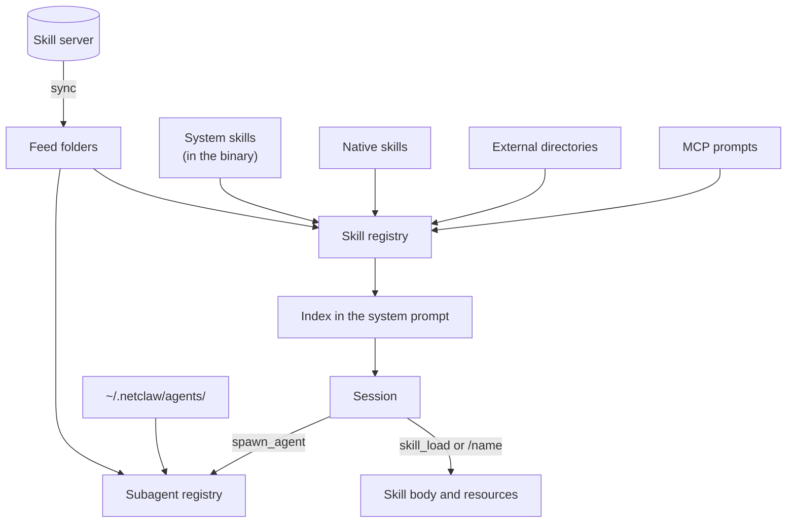

A skill is a markdown file that teaches the agent how to do one thing: your team's commit conventions, a deploy checklist, how to triage a failing pod. A subagent is a separate markdown file that defines a specialist the agent can hand a bounded task to. Both are plain text you can read, diff and keep in git.

netclaw puts a one-line-per-skill index into the system prompt when a session starts. The model reads full instructions only when it needs them, so a big library costs a few lines of context. You can also start a skill yourself by typing `/skill-name` at the start of a message.

Skills use the [AgentSkills.io](https://agentskills.io) format, a `SKILL.md` with YAML frontmatter, so most skills you write for netclaw also work in other agent tools.

## Where skills come from



| Tier | Location | Managed by |
|------|----------|-----------|
| system | `~/.netclaw/skills/.system/` | The daemon. Restored from the binary on every start. |
| native | `~/.netclaw/skills/` | You, or the agent through `skill_manage` |
| server feed | `~/.netclaw/skills/.server-feeds/<feed>/` | A [skill server](/skills/skill-server/) you subscribe to. See [Skill feeds](/skills/skill-feeds/). |
| external | Directories you add | The tool that owns them. See [External skills](/skills/external-skills/). |
| MCP prompt | Not on disk | A connected [MCP server](/configuration/mcp-servers/) |

Subagent definitions live next to skills but load separately. Your own are in `~/.netclaw/agents/`, and a skill server can install more into `~/.netclaw/agents/.server-feeds/<feed>/`. See [Custom subagents](/skills/custom-subagents/).

### System skills

The daemon ships nine system skills, embedded in the binary: `agent-coordination`, `netclaw-memory`, `netclaw-operations`, `netclaw-projects`, `run-reminder`, `search-citation`, `skill-authoring`, `subagent-authoring` and `web-content-retrieval`. Nothing downloads. Every daemon start replaces the `.system` folder with the copies in the binary, so edits there don't survive a restart.

There is no setting to turn system skill sync off. 0.27.0 removed `SkillSync.DisableSystemSkillSync`, and `netclaw doctor --fix` deletes it from an old config.

### Precedence

When two sources define the same name, the higher tier wins and the other copy shows up as a `DuplicateName` issue:

```
system  >  native  >  server feeds  >  external
```

Feeds rank in the order they appear in `SkillFeeds.Feeds`, and external sources in the order of `ExternalSkills.Sources`. A system skill beats a native skill of the same name, so you can't shadow `netclaw-memory` by dropping a file in `~/.netclaw/skills/`. A native skill beats everything you sync or point at.

### MCP prompts

Prompts from connected MCP servers appear as skills named `mcp__<server>__<prompt>`. They show up in [`netclaw skill list`](/cli/skill/) with source `mcp`, and the agent loads them through `skill_load` with an `arguments` map. They aren't files, so there is nothing to edit, and they don't become `/` commands.

## What a skill looks like

Two layouts work. A directory holds a skill with supporting files, and a flat file holds a self-contained one:

```
commit/
  SKILL.md          # required: frontmatter + instructions
  references/       # optional: material the agent can read
  scripts/          # optional: scripts the agent can run
  assets/           # optional: templates, images

commit.md           # flat-file alternative
```

```yaml
---
name: commit
description: Create well-structured git commits with conventional commit messages.
metadata:
  version: 1.0.0
argument-hint: "<scope>"
---

# Commit changes

Instructions for the agent go here.
```

| Field | Required | Description |
|-------|----------|-------------|
| `description` | Yes | One line, up to 1024 characters. The model sees it in the index, so say when to use the skill. |
| `name` | No | Lowercase identifier. Defaults to the directory or file name. When you set it on a native skill it must match that name. |
| `metadata.version` | No | A version string like `1.0.0`. A top-level `version:` key is ignored, and `netclaw skill list` shows `-`. |
| `invocable` | No | Defaults to `true`. Set `false` to hide the skill from `/` commands. |
| `disable-model-invocation` | No | Set `true` to keep the skill out of the index. You can still run it with `/name`. |
| `argument-hint` | No | Text shown after the command name, like `<scope>`. |
| `metadata.subagent` | No | Name of a subagent to run the skill instead of returning its text. |
| `allowed-tools` | No | Informational only. It never grants access. |
| `license`, `compatibility` | No | Free-form strings. `compatibility` is a single string, not a list. |

netclaw ignores unknown keys, so a misspelled one fails silently. The key is `invocable`, not `user-invocable`. `netclaw skill list` shows the `name` key. The `Display:` line in `netclaw skill show` comes from the first `#` heading in the body, or from the title-cased name when there is none.

Files under a skill directory other than `SKILL.md` count as resources. A skill server can ship them as a zip archive, and netclaw extracts it into an ordinary skill folder. See [Bundling resources with skills](/skills/bundled-resources/).

## How skills get used

| Path | What happens |
|------|-------------|
| The model loads a skill | It reads the index, calls `skill_load` with the name, and gets the body plus a list of resource files. It reads a resource with `skill_read_resource`, which returns the file's absolute path on the first line so the agent can run a bundled script. |
| You type `/name` | The text after the name becomes your message, and netclaw adds the skill body to that turn. With no text, netclaw tells the model you invoked the skill. See [Slash commands](/reference/slash-commands/). |
| A skill has `metadata.subagent` | Loading it, or typing its `/name`, starts that subagent in the background with the skill body as extra instructions and your text as the task. The call returns the accepted run, and the result arrives in a later turn as a notice that names `result.md`. The subagent runs with the session's effective audience. The target has to exist and be `user-facing`. The model has to pass a `task` when it loads one. |
| The model calls an MCP prompt skill | `skill_load` returns the prompt's messages. Pass `arguments` for prompts that take them. |

Routing example:

```yaml
---
name: research
description: Deep research on a topic using multiple sources.
metadata:
  subagent: research-assistant
---
```

The model sees the index only in sessions with a Team or Personal audience. Public sessions get no index, and `skill_load` returns an error for them. `SkillSync.Enabled: false` empties the index and makes `skill_load` and `skill_read_resource` refuse for every audience.

New and edited skill files are picked up without a restart. A file watcher on the native, feed and external directories rescans after a 500 ms pause. New sessions see the updated index. Changing which sources exist, such as adding an external directory, restarts the daemon in-process.

## Trust and safety

netclaw does not scan skill content. The scanner is turned off ([netclaw#976](https://github.com/netclaw-dev/netclaw/issues/976)), so a skill from any tier loads as written. Prompt-injection detection still runs on inbound channel messages. Treat a skill as instructions you are giving the agent and install only skills you've read or whose source you trust.

What does protect you:

- Feed downloads are checked against the server's SHA-256 digest, and a mismatch is rejected.
- Synced files are hash-checked. If anything edits a feed skill folder or a system skill, the next sync or daemon start puts the published copy back.
- `skill_manage` refuses to edit system, feed and external skills. Only native skills are editable.
- `allowed-tools` grants nothing. Tool access comes from the [security policy](/security/security-model/), and a skill runs under the same approvals as any other turn.
- Symlinks are rejected in native and system directories. An external source can opt in with `AllowSymlinks`.

The skill folders are writable by the agent, so a script bundled with a feed skill can run through the shell tool. That only works in sessions whose audience allows `shell_execute`.

## Configuration

Most setup happens in [`netclaw config`](/cli/config/) under **Skill Sources**, where you add local folders and skill servers.


The screen lists local folders with their skill counts, and remote servers appear alongside them with how many skills each advertises.

| Key | Default | Description |
|-----|---------|-------------|
| `SkillSync.Enabled` | `true` | When `false`, the skill index is empty and the skill tools refuse every call. |
| `SkillFeeds` | none | Skill servers to sync from. See [Skill feeds](/skills/skill-feeds/). |
| `ExternalSkills.Sources` | none | Extra skill directories. See [External skills](/skills/external-skills/). |

To see what the agent has loaded, run `netclaw skill list` (the daemon has to be running). To see which skills it uses, run [`netclaw stats skills`](/cli/stats/).

## Limitations

- Skills are text. They can't register tools or change daemon behavior.
- There's no version history or rollback for native skills. Overwrite one and the old copy is gone, so keep yours in git.
- `skill list` shows skills from a skill server with source `native`, because they live under `~/.netclaw/skills/`. The offline commands `show`, `search`, `issues` and `remove` don't see them. See [`netclaw skill`](/cli/skill/).
- There's no public marketplace. Skills come from the sources you configure.

## Related pages

- [Skill feeds](/skills/skill-feeds/): sync skills and subagents from a skill server
- [External skills](/skills/external-skills/): read skills from Claude Code or any directory
- [Custom subagents](/skills/custom-subagents/): define subagents and spawn them
- [`netclaw skill`](/cli/skill/): list, inspect and validate skills
- [Slash commands](/reference/slash-commands/): `/name` and the other commands you can type

## Resources

- [AgentSkills.io](https://agentskills.io): the `SKILL.md` format specification
- [Cloudflare Agent Skills Discovery RFC](https://github.com/cloudflare/agent-skills-discovery-rfc): the protocol behind skill feeds
- [netclaw skill-server](https://github.com/netclaw-dev/skill-server): the self-hosted skill registry
