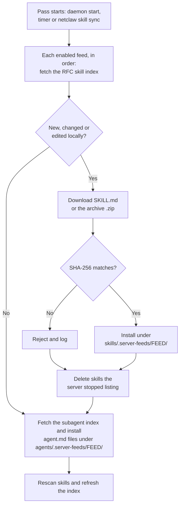

A skill feed connects the daemon to a [skill server](/skills/skill-server/). The daemon reads the server's skill index, downloads what changed, verifies each download against a SHA-256 digest, and installs skills and subagents where the agent can use them. Use a feed to give every netclaw instance in your organization the same skills without copying files around.

Feeds are the remote counterpart of [external skills](/skills/external-skills/), which point at directories on disk.

## How a sync pass works



Feeds sync one after another. A feed that fails is skipped and the daemon keeps using the files from its last good sync, but a slow feed delays the ones after it by up to its `TimeoutSeconds`.

Skills come from the server's [RFC index](https://github.com/cloudflare/agent-skills-discovery-rfc). Each entry is either a single `skill-md` file or an `archive`, a zip that holds the skill's `references/`, `scripts/` and `assets/` as well. netclaw verifies the zip's digest first, then extracts it with hardening against path traversal, symlink entries and duplicate names. See [Bundling resources with skills](/skills/bundled-resources/).

Subagents come from the server's [native manifest](/skills/native-manifest/), which the RFC index doesn't carry. A server with no native manifest still works for skills, and the pass reports `sidecar=absent`.

## Add a feed

Feeds aren't managed by `netclaw skill source`. That command only handles local directories. Add a server through `netclaw config` or by editing `netclaw.json`.

### In the config menu

Run `netclaw config`, open **Skill Sources**, choose **+ Add skill server** and enter the base URL. The screen probes the server, shows how many skills it advertises, and suggests a name from the hostname. If the server needs a bearer token, it asks for one.


A skill server you add appears under **Remote skill servers**, like Corp Skills here. Once its feed has been read, the count next to it is what it publishes, which can be higher than what `netclaw skill list` shows once sync finishes.

### In netclaw.json

```json
{
  "SkillFeeds": {
    "SyncIntervalMinutes": 60,
    "Feeds": [
      {
        "Name": "corp-skills",
        "Url": "https://skills.example.com",
        "Enabled": true,
        "TimeoutSeconds": 30
      }
    ]
  }
}
```

The daemon restarts itself when `netclaw.json` changes and runs a sync pass as it starts. Run `netclaw doctor` after hand edits to catch schema errors.

| Field | Type | Default | Description |
|-------|------|---------|-------------|
| `Name` | string | - | Feed identifier and folder name. Lowercase letters, digits and hyphens only (`^[a-z0-9-]+$`). |
| `Url` | string | - | Server base URL. The daemon adds `/.well-known/agent-skills/index.json`. |
| `Enabled` | bool | `true` | Turn a feed off without deleting it. |
| `TimeoutSeconds` | int | `30` | Per-request HTTP timeout, 1 to 300. |
| `ApiKey` | string | none | Bearer token. Supports the `ENC:` prefix for encrypted storage. |

`SyncIntervalMinutes` (default `60`, range 0 to 1440) sets the timer. `0` means sync at startup only.

A skill server serves reads without a key, so you only need `ApiKey` when something in front of it, like a proxy, requires one. A publishing key is a different thing and never belongs in netclaw's config. See [Skill server](/skills/skill-server/#manage-api-keys).

## When syncs run

| Trigger | Timing |
|---------|--------|
| Daemon start, including the restart after a config change | Immediately. A failure never blocks startup. |
| Timer | Every `SyncIntervalMinutes`. The first tick adds 0 to 5 minutes of random jitter. |
| `netclaw skill sync` | Right now. If a pass is already running, it waits for that one. |

To pull a skill you just published, run `netclaw skill sync`. It needs the running daemon.

```bash
netclaw skill sync
```

```text
Waiting for the daemon's skill sync pass. Press Ctrl+C to stop this wait.
Skill sync pass a304191e2ce04fc28782ad22f8385c2d
corp-skills: ok changed=0 unchanged=2 rejected=0 failed=0 sidecar=complete
Inventory: ok accepted=12 rejected=0
```

Each feed gets one line. `changed` counts skills installed, updated or deleted, and `sidecar` reports the subagent pass:

| `sidecar` | Meaning |
|-----------|---------|
| `complete` | Subagents synced, or the server has none. |
| `absent` | The server has no native manifest, so there's nothing to sync. |
| `failed` | A subagent request or file failed. Existing subagent files stay. |
| `not-run` | The skill index request failed, so subagents weren't attempted. |

The command exits 1 if any feed reports `failed` or `rejected` above zero, or the inventory refresh fails. Ctrl+C stops the wait, not the pass.

```text
corp-skills: failed changed=0 unchanged=0 rejected=0 failed=1 sidecar=not-run
  Error: The RFC index request failed.
```

## What lands where

| What | Location |
|------|----------|
| Skills | `~/.netclaw/skills/.server-feeds/<feed>/<skill>/` |
| Subagents | `~/.netclaw/agents/.server-feeds/<feed>/<agent>.md` |
| Sync state | `.sync-state.json` in each of the two feed folders |

`netclaw skill list` labels feed skills `native`, because they live under `~/.netclaw/skills/`. To tell them apart, look at the path or the `corp-skills` folder.

### Updates, edits and removals

- **Updates.** A skill installs again when the server's version or digest differs from the sync state. Bump `metadata.version` in `SKILL.md` and publish. netclaw shows the version from that frontmatter key, not the number you passed to the publish command.
- **Local edits.** netclaw records a hash of every installed file. If anything edits, adds or deletes a file in a feed skill folder, the next pass reinstalls the published version. Subagent files aren't hash-checked, so an edited subagent stays edited until its version changes.
- **Removals.** When the server stops listing a skill, the next pass deletes it. Pruning only runs when the server returns a non-empty index, so an outage or an empty response never wipes your skills. Subagents are pruned only after every page and item synced cleanly.
- **First sync after an upgrade.** Skills installed before hash tracking get downloaded once more to record hashes.

### Name clashes

Native and system skills beat feed skills, and feed skills beat external ones. Between feeds, the one listed first in `SkillFeeds.Feeds` wins. For subagents, any definition in `~/.netclaw/agents/*.md` beats a feed copy of the same name, and netclaw logs a warning. To override a feed skill, create a native skill with the same name.

## Authoring for a feed

A feed serves skills in the [AgentSkills.io](https://agentskills.io) format. Three feed-specific rules:

- Put `version` under `metadata:`. The skill server's CLI accepts a top-level `version:` key too, but netclaw ignores it and shows `-`. Under `metadata:` both read it.
- Names are 1 to 64 characters of lowercase letters, digits and single hyphens.
- A skill that has a `references/`, `scripts/` or `assets/` folder publishes as an archive automatically.

The full format is in [Skills overview](/skills/overview/). Publishing is covered by the [`skillserver` CLI](/skills/skillserver-cli/) page.

## Security

netclaw checks the SHA-256 digest of every skill, archive and subagent a feed serves and rejects a file that doesn't match. It does not scan skill content. The scanner is off ([netclaw#976](https://github.com/netclaw-dev/netclaw/issues/976)), so a feed skill loads exactly as the server published it. Subscribe only to servers you run or trust. See [Trust and safety](/skills/overview/#trust-and-safety).

Subagent files are prompts. A subagent from a feed runs with the same tools and approvals as one you wrote, so read what a feed publishes.

`netclaw skill issues` doesn't show feed rejections. A rejected file shows up in the daemon log and in the `rejected` count of `netclaw skill sync`.

## Troubleshooting

### A feed shows 0 skills

- **Symptom:** The server row says `0 advertised`, or no skills appear after a sync.
- **Cause:** The URL is wrong, or the server isn't serving its index.
- **Fix:** Check the index, and check that the feed is enabled in `netclaw config` or `SkillFeeds.Feeds`:

```bash
curl -s https://skills.example.com/.well-known/agent-skills/index.json | head
```

### A published skill doesn't show up

- **Symptom:** You published a skill, but `netclaw skill list` doesn't show it.
- **Cause:** The timer hasn't fired yet, or the version didn't change.
- **Fix:** Run `netclaw skill sync`. If the line says `unchanged`, publish a new `metadata.version`.

### The sync line says `failed`

- **Symptom:** `netclaw skill sync` exits 1 with `failed=1`.
- **Cause:** The server was unreachable or slow, or one skill failed to download or verify.
- **Fix:** Read the `Error:` line and the daemon log at `~/.netclaw/logs/`. Existing skills stay in place. Raise `TimeoutSeconds` for a slow server.

### A subagent doesn't appear

- **Symptom:** The server lists a subagent, but `spawn_agent` can't find it.
- **Cause:** A local agent with the same name wins, the feed shows `sidecar=absent` or `failed`, or the file failed validation.
- **Fix:** Check `~/.netclaw/agents/.server-feeds/<feed>/` for the file. A name clash and a validation failure both log a warning in the daemon log.

## Related pages

- [Skills overview](/skills/overview/): tiers, precedence and trust
- [Skill server](/skills/skill-server/): run the server a feed points at
- [Native manifest](/skills/native-manifest/): how subagents reach netclaw
- [Distributing subagents](/skills/distributing-subagents/): publish a subagent to a feed
- [`netclaw skill`](/cli/skill/): `skill sync` and the other subcommands

## Resources

- [AgentSkills.io](https://agentskills.io): the `SKILL.md` format specification
- [Cloudflare Agent Skills Discovery RFC](https://github.com/cloudflare/agent-skills-discovery-rfc): the discovery protocol behind skill feeds
- [netclaw-dev/skill-server](https://github.com/netclaw-dev/skill-server): the reference skill server
